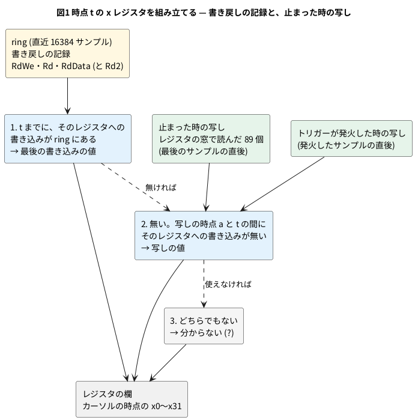

# 13-11 レジスタの欄 — 書き戻しの記録から x0〜x31 を組み立てる

この題は実体配線図と Analog Discovery 3 とオシロの図を付けない。ブラウザと PC の中で動く組まない題で、組む物が無いから。

> [!NOTE]
> この題の数は、公開リポジトリの Wasm の模型を Node で回して取った (2026-11-11、`sim/11-regs-at.mjs` と公開リポジトリの `make wasm-test`)。
> ブラウザの画面での手順は 2026-10-30 に公開ページで確かめた物で、今日は開き直していない。

13-9 と 13-10 では、Logic Analyzer を止めて、割り込みやシステムコールの前後の波形を読んだ。
波形で分かるのは「どの命令が退役したか」までで、その時 `a0` や `sp` に何が入っていたかは、波形の行には無い。
公開ページの Logic Analyzer の下にある「レジスタ」の欄が、それを出す。止めた波形にカーソルを当てると、**その時点の x0〜x31** が出る。

RISC-V の整数レジスタは 32 本、Linux の動く RV64 では 1 本が 64 ビットある。
これを毎クロック全部記録すれば話は簡単だが、そうはしていない。この題では、

1. 毎クロック 32 本を記録しない理由を、ring の語の数で数える
2. 代わりに記録している物 (書き戻し) と、止めた時に 1 度だけ取る物 (写し) から、過去の時点の値を組み立てる決まりを読む
3. 組み立てた値が何本分かり、合っているかを PC で確かめる
4. クロックを動かさずにレジスタを読む口 (レジスタの窓) を見る

をする。

## 記録する物を選ぶ

ring (4-8) は、1 クロックに 1 サンプル、直近の決まった数だけを残す輪の形のバッファである。
このページの ring は 1 サンプル 17 語 (1 語 32 ビット) で、16384 サンプルぶんある。

| 記録のしかた | 1 サンプル | ring の大きさ (16384 サンプル) |
| --- | --- | --- |
| 今の形 (退役・PC・命令・トラップ・割り込み・書き戻し 2 つ など) | 17 語 | 1 114 112 バイト (約 1.1 MB) |
| x1〜x31 の 64 ビットも毎クロック足す | 17 + 62 = 79 語 | 5 177 344 バイト (約 5.2 MB、4.6 倍) |

- ページは動いている間、ring を 0.1 秒ごとに丸ごと写して画面に渡す (Worker から画面へ。4-9)。4.6 倍にすると、写す量も 4.6 倍になる
- しかも足した 62 語は、ほとんどのクロックで前と同じ値である。レジスタが変わるのは、命令が退役して答えを書き戻した時だけで、1 命令が書くのは多くて 1 本。`ls /` の途中で止めた ring では、16384 クロックのうち書き戻しがあったのは 3 995 クロック (24%) だった
- そこで ring には**書き戻し**だけを記録する。「退役した命令が、どのレジスタに、何を書いたか」の 3 つで、語にすると 2 語と 5 ビット。変わらなかった 30 本は記録しない

書き戻しの記録は、模型のトップのポートから取る。

| ポート (`obs_*`) | ring の場所 | 意味 |
| --- | --- | --- |
| `obs_rd_we` | 語 0 のビット 13 (画面の `RdWe`) | 退役した命令が整数レジスタに書いた |
| `obs_rd` | 語 9 のビット 4〜0 (`Rd`) | 書いたレジスタの番号 |
| `obs_rd_data` | 語 6・7 (`RdData`・`RdHi`) | 書いた値の下・上 32 ビット |
| `obs_rd2_we`・`obs_rd2`・`obs_rd2_data` | 語 9 のビット 31〜27 (`Rd2`)、語 15・16 (`Rd2Data`) | 2 つ目の書き込み口。浮動小数点の演算の答えが整数レジスタに入る時 (`feq`・`fcvt.l.d` など) |

## 過去の時点の値を組み立てる

書き戻しの記録だけでは足りない。ring に残っている間に 1 度も書かれなかったレジスタの値は、記録のどこにも無い。
それを補うのが**写し**で、ring が止まった直後に 1 度だけ、32 本を全部読んで取っておく。




決まりは 3 つで、レジスタ 1 本ずつに当てる (`web/regs-panel.js` の `_xAt`)。

1. 時点 t までに、そのレジスタへの書き込みが ring にあれば、最後の書き込みの値
2. 無ければ写しを使う。写しはサンプル a の直後の値なので、t から a までの間にそのレジスタへの書き込みがあれば、写しの値は t の値と違う。書き込みが無い時だけ使える
3. どちらでもなければ分からない。欄には `?` を並べて出す

写しは 2 つある。止まった時の写し (a は最後のサンプル) と、トリガーが発火した時の写し (a は発火したサンプル) である。
トリガーで止めると、発火の後も post のサンプル数だけ記録が続く。発火の時の写しがあれば、発火より前で、発火の後に書かれたレジスタも分かる。

気を付ける所が 3 つある。どれも「記録と写しの間が 1 クロックずれる」か「記録が途切れる」話である。

- **書き戻しは次の立ち上がりでレジスタファイルに入る**。サンプル a と同じクロックで取った写しには、a で書いた値がまだ入っていない。だから決まり 2 で見る書き込みの範囲は、t の次から a の 1 つ前まで。a の時点そのものの値は、決まり 1 (記録) が先に当たるので困らない
- **「事象のあるクロックだけ」(13-10) で手で止めると、写しが最後のサンプルより後のクロックになることがある**。最後のサンプルの後に、記録されなかったクロックが挟まるため。この時の写しは最後のサンプルの書き込みを含む。ハーネスは写しを取ったクロック数を別に返し (`sim_regs_cycle`)、ページはそれを最後のサンプルのクロック数と比べて、範囲を a までにするか a の 1 つ前までにするかを決める
- **ring には途切れがある**。Logic Analyzer を止めている間も模型は回るので、再開した後の最初のサンプルと、その前のサンプルの間に、記録の無いクロックがある。ハーネスは途切れの後の最初のサンプルに印を付け (語 9 のビット 26)、ページは見ている時点と同じ途切れの間の記録と写しだけを使う

f0〜f31 (浮動小数点) と CSR には書き戻しの記録が無い。この 2 つは、カーソルをどこに当てても、止まった時の値を出す。

## レジスタの窓

写しを取るには、CPU のレジスタを外から読む口が要る。模型のトップに、番号を入れると値が出る組み合わせ回路を足してある。

| `reg_sel` | `reg_val` に出る物 |
| --- | --- |
| 0〜31 | x0〜x31 (x0 はいつも 0) |
| 32〜63 | f0〜f31 |
| 64〜88 | CSR 25 個。特権・`mstatus`・`mie`・`mip`・`mtvec`・`mepc`・`mcause`・`mtval`・`mscratch`・`medeleg`・`mideleg`・`sstatus`・`sie`・`sip`・`stvec`・`sepc`・`scause`・`stval`・`sscratch`・`satp`・`stimecmp`・`mcycle`・`minstret`・`mtime`・`fcsr` |

ハーネス (`sim/wasm/harness.cpp`) の読み方は次のとおり。

```cpp
// reg_sel を置いて eval し、reg_val を読む。clk は動かさないので、組み合わせの値が変わるだけ
void read_regs(uint64_t* dst) {
    for (int i = 0; i < kRegCount; i++) {
        g_top->reg_sel = static_cast<uint8_t>(i);
        g_top->eval();
        dst[i] = g_top->reg_val;
    }
    if (dst == g_regs) g_regs_cycle = static_cast<double>(g_top->cycle_count);
}
```

- 5-3 で見たとおり、Verilator の模型は「入力を置く → `eval()` → 出力を読む」で動く。クロックを動かさずに `eval()` を呼ぶと、組み合わせ回路の出力だけが新しい入力に合わせて変わり、フリップフロップは動かない。89 個読んでも、模型の状態は 1 クロックも進まない
- 実物の FPGA では、こうは読めない。89 個を一度に外へ出すにはピンか JTAG のような口が要り、読む間 CPU を止める仕掛けも要る。計算で真似ている模型だから、止めずに横から覗ける (0-1)
- mmRISC-2 のレジスタファイルは 2 つの組 (バンク) と「どちらが新しいか」の表を持つ。窓は表を見て新しい方を出す (`cores/mmrisc2/tb_mmrisc2.sv`。上流の RTL は書き換えず、トップから階層の名前で引いている)
- 動いている間のレジスタの欄は、0.1 秒ごとにこの窓を読んだ値である。1 回に `eval()` を 89 回呼ぶが、1 秒に 30 万クロック回す中の 890 回なので、速さにはほとんど響かない (13-8)

## 手順

### ブラウザで見る

1. 公開ページ <https://tommie-jp.github.io/soft-fpga-riscv-linux/mmrisc2/> を開き、プロンプトが出るまで待つ (13-1)。「レジスタ」の欄の頭に「動作中の値 (約 0.1 秒ごと)」と出ている
2. プリセット「システムコール / System call」を Set し、端末で字を打つ (13-10)。止まると、欄の頭が「カーソルの時点 T=… · clk … · PC … · (読んだ命令)」に替わる
3. 波形の上でマウスを動かす。カーソルの時点に合わせて x0〜x31 が替わる。**黄色**の箱は、その時点のサンプルで書いたレジスタ。前に出していた値から変わった箱にも色が付く
4. 発火の位置 (赤い縦線) にカーソルを当て、`a7` (x17) を読む。システムコールの番号が入っている (`ac` なら 172 = `getpid`)
5. 「トラップの記録」の行を押すと、マーカー A がそのトラップに置かれる。カーソルを波形の外に出すと、欄はマーカー A の時点になる
6. ring のいちばん古い側までさかのぼると、`????????????????` の箱が出てくる。その時点より後に書かれていて、それより前の値が ring に残っていないレジスタである

- カーソルが無い時に見る時点は、マーカー A、トリガーの位置、最後のサンプルの順で決まる
- CSR の `mcause`・`scause` は、値の後ろに原因の名前 (`S-ext`・`ecall-U` など) が付く

### PC で確かめる

用意は 13-9 と同じ。

```bash
node <教科書>/06-fpga/13-linux/sim/11-regs-at.mjs <soft-fpga-riscv-linux の場所>          # ls / の途中で止める
node <教科書>/06-fpga/13-linux/sim/11-regs-at.mjs <soft-fpga-riscv-linux の場所> 1        # 事象のあるクロックだけ
node <教科書>/06-fpga/13-linux/sim/11-regs-at.mjs <soft-fpga-riscv-linux の場所> 0 idle   # 寝ている所で止める
make -C <soft-fpga-riscv-linux の場所> wasm-test                                          # 公開リポジトリの試験
```

`11-regs-at.mjs` は、決まり 1 と 2 を自分で書き直した物で (ページの `regs-panel.js` を呼んではいない)、次のことをする。

- 始めにレジスタの窓を読み、その後の書き戻しを全部追って、「本当の値」を持っておく (13-9 の `sim/09-trace-lib.mjs` で ring を途切れなく読む)
- `ls /` を送って 200 万クロック回した所で ring を止め、写しを取る
- 止めた ring の中の 11 の時点で、決まり 1・2 で x1〜x31 を組み立て、何本が記録から・写しから分かったか、分かった値が本当の値と合うかを出す

```text
mode 0: ring 16384 x 17 words = 1114112 bytes, window 89 regs
frozen at clock 339328446, ring spans 16384 clocks, snapshot on the last sample
writebacks in the ring: 3995, registers written at least once: 31 of 31
T=-    0 (clock 339328446): from ring 31, from snapshot  0, unknown  0, wrong 0
T=- 4000 (clock 339324446): from ring 31, from snapshot  0, unknown  0, wrong 0
T=-12000 (clock 339316446): from ring 31, from snapshot  0, unknown  0, wrong 0
T=-14000 (clock 339314446): from ring 29, from snapshot  0, unknown  2, wrong 0
T=-16000 (clock 339312446): from ring 24, from snapshot  0, unknown  7, wrong 0
T=-16300 (clock 339312146): from ring 12, from snapshot  0, unknown 19, wrong 0
T=-16383 (clock 339312063): from ring  0, from snapshot  0, unknown 31, wrong 0
window read twice while running: same true, clock moved 0
PASS
```

(11 行のうち 7 行を載せた。)

## 読めること

| 止めた所 | 記録 | ring に入ったクロック | 書き戻し | 最後から 12 000 サンプル前 | 16 000 サンプル前 | いちばん古いサンプル |
| --- | --- | --- | --- | --- | --- | --- |
| `ls /` の途中 | 毎クロック | 16 384 | 3 995 | 31 本とも記録から | 記録から 24、`?` 7 | `?` 31 |
| `ls /` の途中 | 事象のあるクロックだけ | 30 991 | 9 637 | 記録から 24、`?` 7 | 記録から 22、`?` 9 | 記録から 1、`?` 30 |
| 寝ている所 (`wfi`) | 毎クロック | 16 384 | 0 | 31 本とも写しから | 31 本とも写しから | 31 本とも写しから |

- **動いている所で止めると、ほとんどは記録だけで決まる**。`ls /` の途中の ring では、31 本とも 1 度は書かれていた。カーネルはトラップの出入りでレジスタを全部しまって戻すので (13-10 の `getpid` で 289 命令)、トラップから戻る所を 1 つ含めば全部が書かれる。その後の時点では写しの出番が無い
- **`?` が出るのは ring の古い側**。まだ 1 度も書かれていない時点では決まり 1 が使えず、後で書かれているので決まり 2 も使えない。毎クロックの記録なら、古い方の 2 000〜4 000 サンプルで少しずつ `?` が増える
- **寝ている所で止めると、全部が写しから決まる**。`wfi` で止まっている 16384 クロックには書き戻しが 1 つも無く、どの時点も写しと同じ値である
- 分かった値は、3 通りの 33 の時点で、全部が本当の値と合った (`wrong 0`)
- レジスタの窓を続けて 2 度読むと 89 個とも同じ値で、読む前後で模型のクロック数は変わらなかった

公開リポジトリの `make wasm-test` (`sim/wasm/test-la.mjs`) は、同じ事をページの決まりに沿ってもっと広く確かめる。今日は 89 項目が全部通った。

| 確かめること | 今日の結果 |
| --- | --- |
| 逆アセンブラが既知の符号 32 個を読む (`Asm` の行と欄の頭の命令) | 通った |
| 止める所を変えて 12 回止め、書き戻しの最後の値がレジスタの窓と合う (1 回に 31 本) | 12 回とも通った |
| 止めた後に回しても、写しは止めた時の物のまま | 12 回とも通った |
| 写しを取ったクロックが、最後のサンプルのクロックと同じ | 12 回とも通った |
| トリガーが発火した時の写しが、発火の前の書き込み (31 本) と合う。発火の後に書かれていない 3 本は止まった時の写しと合う | 通った |
| 途切れの印が、再開した次のサンプルだけに付く | 通った |
| 「事象のあるクロックだけ」で止めても合う (6 回。写しが最後のサンプルの後になった 4 回を含む) | 6 回とも通った |
| 「事象のあるクロックだけ」の 2000 サンプルが 4600 クロックに当たり、どのサンプルにも記録した訳がある | 通った |

## 見るべき値

公開リポジトリの fd1efd5 (mmRISC-2 は Rev.02-4-gc9587f7) の Wasm の模型を Node 24 で回し、保存ファイル `mmrisc2-67c16bf6.state.gz` から始めた (2026-11-11)。

| 見る所 | 値 | 種類 |
| --- | --- | --- |
| ring の大きさ | 16384 サンプル × 17 語 = 1 114 112 バイト | 動かして確かめた |
| x1〜x31 を毎クロック足した時 | 79 語、5 177 344 バイト (4.6 倍) | 計算値 |
| レジスタの窓の数 | 89 個 (x 32・f 32・CSR 25) | 動かして確かめた |
| `ls /` の途中の ring の書き戻し | 3 995 (16384 クロックの 24%)。31 本とも 1 度は書かれる | 動かして確かめた |
| 12 000 サンプル前まで | 31 本とも分かる (毎クロックの記録) | 動かして確かめた |
| いちばん古いサンプル | 31 本とも `?` | 動かして確かめた |
| 「事象のあるクロックだけ」の ring の長さ | 30 991 クロック (1.9 倍)、書き戻し 9 637 | 動かして確かめた |
| 寝ている所の ring | 書き戻し 0。どの時点も 31 本とも写しから | 動かして確かめた |
| 組み立てた値の誤り | 33 の時点で 0 | 動かして確かめた |
| レジスタの窓を読んだ時に進むクロック | 0 | 動かして確かめた |
| 公開リポジトリの試験 | 89 項目とも通る (`ALL PASS`) | 動かして確かめた |
| トラップの記録の行を押すと、欄がその時点になり、x0〜x31 が 32 本とも分かる | 公開ページで | 2026-10-30 にブラウザで確かめた |

- 「事象のあるクロックだけ」の ring が 1.9 倍にしかならないのは、止めた所が `ls` の子が動いている最中で、待ちのクロックが少ないため。`ls /` の全体では平均 3.22 倍 (13-10)

## シミュレーションでの確かめ

`sim/11-regs-at.mjs` を 3 通りと、公開リポジトリの `make wasm-test` を、fd1efd5 を `make wasm` した模型で回した (Node 24.14、2026-11-11)。

| 項目 | 本文の数字 | 実行結果 | 判定 |
| --- | --- | --- | --- |
| ring の大きさと窓の数 | 1 114 112 バイト・89 個 | 同じ | 合った |
| 毎クロック足した時 | 79 語、4.6 倍 | 17 + 31 × 2 = 79、16384 × 79 × 4 = 5 177 344、79 ÷ 17 = 4.65 | 合った (計算) |
| 書き戻しの割合 | 24% | 3 995 ÷ 16 384 = 24.4% | 合った (計算) |
| 「読めること」の表の本数 | 3 通りの行のとおり | 同じ (`from ring`・`from snapshot`・`unknown`) | 合った |
| 組み立てた値 | 誤り 0 | 3 通りとも `wrong 0`、`PASS` | 合った |
| 窓はクロックを動かさない | 進むクロック 0 | `clock moved 0`、2 度読んで同じ | 合った |
| 公開リポジトリの試験 | 89 項目 | `PASS` 89 行、`ALL PASS` | 合った |
| 途切れの印と、発火した時の写しを使う決まり | 本文のとおり | `11-regs-at.mjs` は使わない (止めるのは 1 度)。`make wasm-test` の項目で確かめた | 合った (公開リポジトリの試験) |
| ブラウザでの手順 (カーソル・黄色の箱・トラップの記録) | 手順のとおり | ブラウザが要る。2026-10-30 の確かめを引いた | 対象外 |
| ページの `regs-panel.js` そのもの | — | 画面の部品なので Node では回していない。決まりを書き直して確かめた | 対象外 |

## 出典

自作。

- レジスタの欄 (`web/regs-panel.js`)・ハーネス (`sim/wasm/harness.cpp`)・レジスタの窓 (`cores/mmrisc2/tb_mmrisc2.sv`)・試験 (`sim/wasm/test-la.mjs`): [tommie-jp/soft-fpga-riscv-linux](https://github.com/tommie-jp/soft-fpga-riscv-linux) (Apache-2.0)。公開ページは <https://tommie-jp.github.io/soft-fpga-riscv-linux/>
- Logic Analyzer の画面と ring (`rtlscope_ring.h`): [tommie-jp/soft-fpga](https://github.com/tommie-jp/soft-fpga) (MIT) の rtlscope
- CPU の RTL: [mmRISC-2](https://github.com/munetomo-maruyama/mmRISC-2) (Munetomo Maruyama、Apache-2.0)。動いている Linux カーネルは GPL-2.0、OpenSBI は BSD-2-Clause、BusyBox は GPL-2.0
- レジスタの名前と CSR: [The RISC-V Instruction Set Manual](https://github.com/riscv/riscv-isa-manual) (Volume I の呼び出し規約の名前、Volume II の CSR)
