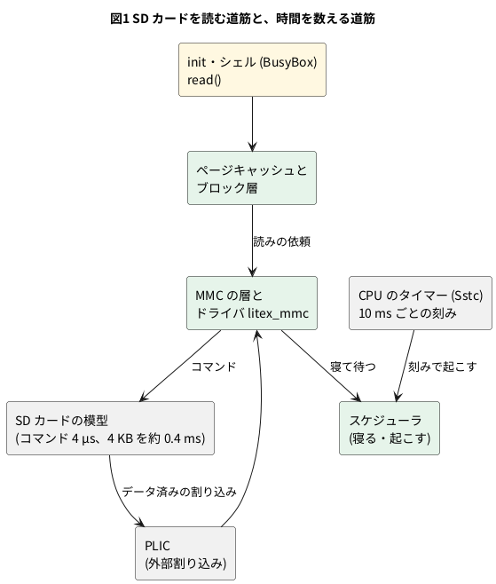

# 13-12 init からシェルまでの待機 — SD の読みの後で次の tick まで寝る

この題は実体配線図と Analog Discovery 3 とオシロの図を付けない。PC の中で動く組まない題で、13-6 の保存ファイルをそのまま使い、測り方だけを足すから。

> [!NOTE]
> この題の数は、PC の Verilator の模型と、その Wasm 版 (Node) で取った (2026-11-11)。実物の FPGA のボードでは動かしていない。

13-3 で起動の記録を読むと、init が起きてからシェルが出るまでの 1.3 億クロックのあいだ、CPU は 11 クロックに 1 命令しか進めていなかった。
実時間で 5 分半、起動の約 4 割が「待っている時間」である。その間 SD カードの割り込みだけが途切れずに増えていた。

この題では、何を待っているのかを確かめる。先に答えを書くと、

- 待っているのは SD カードそのものではない。カードは 4 KB を約 0.4 ms (ミリ秒) で渡し終えている
- カーネルが、読みの後に出す短いコマンド (4 µs (マイクロ秒) で済む) を「5 µs 寝て」待ち、その眠りが 4 回に 3 回、次の刻み (tick、10 ms ごとのタイマー割り込み) まで延びている
- そうなるのは、このカーネルが 1 秒に 100 回の刻みでしか時間を数えない設定だからである

13-6 の保存ファイルから始めるので、14 分の起動をやり直さずに、同じ待ち方を 1 秒ぶんだけ再現して測れる。

## カーネルの時間の刻み

Linux は、タイマー割り込みを 1 秒に `HZ` 回受けて時刻を進める。この 1 回を tick (刻み) と呼ぶ。
mmRISC-2 に付いてくるカーネルの設定 (`LitexSystem/software/boot/linux.config`) は次のとおり。

| 設定 | 値 | 意味 |
| --- | --- | --- |
| `CONFIG_HZ` | 100 | 刻みは 10 ms ごと |
| `CONFIG_HZ_PERIODIC` | y | 暇なときも刻みを止めない |
| `CONFIG_HIGH_RES_TIMERS` | 設定なし | 刻みより細かいタイマーを持たない |

高分解能タイマーが無いカーネルでは、「5 µs 寝る」と頼んでも、起こしてもらえるのは次の刻みである。
寝る長さは頼んだ長さではなく、次の刻みまでの残り (0〜10 ms) になる。




- SD カードの割り込みは PLIC を通る外部割り込み (トラップの原因 9)。刻みは CPU の中のタイマー (Sstc の `stimecmp`) で、原因 5。Logic Analyzer の ring では、この 2 つをトラップの原因で見分けられる (13-9)
- 模型のクロックは 50 MHz。10 ms は 50 万クロックで、PC の模擬では約 1.3 秒かかる

## 手順

### 保存した所から SD カードを読ませる

13-6 の保存ファイルから始め、キャッシュを捨ててから SD カードを直に読む。2 回読んで、キャッシュに無い時とある時を比べる。

```bash
cd soft-fpga-riscv-linux
printf '%s\n' 'cat /proc/interrupts' \
  'echo 3 > /proc/sys/vm/drop_caches' \
  'time dd if=/dev/mmcblk0 of=/dev/null bs=4096 count=64' \
  'cat /proc/interrupts' \
  'time dd if=/dev/mmcblk0 of=/dev/null bs=4096 count=64' \
  'cat /proc/interrupts' | make restore
```

```text
# time dd if=/dev/mmcblk0 of=/dev/null bs=4096 count=64
64+0 records in
64+0 records out
real    0m 0.98s
user    0m 0.04s
sys     0m 0.08s
# cat /proc/interrupts
            CPU0       
  10:        752  RISC-V INTC    5 Edge      riscv-timer
  12:        339  SiFive PLIC    1 Edge      liteuart
  15:        543  SiFive PLIC    4 Edge      litex-mmc
# time dd if=/dev/mmcblk0 of=/dev/null bs=4096 count=64
64+0 records in
64+0 records out
real    0m 0.04s
user    0m 0.00s
sys     0m 0.04s
```

(抜き書き。`@@` の行と、割り込みの表の 0 の行は省いた。1 回目の `dd` の前の `litex-mmc` は 379)

`time` の値は模型の中の時間である。PC ではこの 1 回目の `dd` に 2 分ほどかかる。

### 読み 1 回ごとの時刻を取る

`time` では内訳が分からないので、Wasm 版の模型 (13-8) を Node で回し、Logic Analyzer の ring を全クロック読む。
この題の `sim/12-sd-read-trace.mjs` は、`dd` の行を打ってからプロンプトが戻るまでのあいだ、次の時刻を拾って CSV にする。

- SD カードの模型が動き出した・コマンドが済んだ・データが済んだ (ring の語 9 の SD の状態と 2 つの「済み」)
- S モードの外部割り込みとタイマー割り込みのトラップ (語 0 のトラップと原因)

```bash
SIM_MJS=soft-fpga-riscv-linux/build/mmrisc2/wasm/sim.mjs \
  node sim/12-sd-read-trace.mjs soft-fpga-riscv-linux/state/mmrisc2-67c16bf6.state.gz > reads.csv
```

```text
dd line to prompt: 58133808 clocks = 1162.7 ms of model time
SD commands: 290, with a data transfer: 145
retired 5333785 in 58133808 recorded clocks (0.092 per clock), wfi retired 138
S timer interrupts: 116, interval [ms]: n=115 mean=10.000 median=10.000 min=9.911 max=10.086
start -> cmd done [ms]: n=290 mean=0.004 median=0.004 min=0.004 max=0.004
start -> data done [ms]: n=145 mean=0.411 median=0.411 min=0.398 max=0.428
```

(抜き書き。約 5800 万クロックを 2000 クロックずつ回して ring を読むので、Node で 3 分ほどかかる)

## 読めること

### キャッシュに無い読みは 25 倍遅い

| 回 | 模型の中の時間 (`real`) | SD カードの割り込み |
| --- | --- | --- |
| 1 回目 (キャッシュに無い) | 0.98 秒 | 379 → 543 (164 回) |
| 2 回目 (キャッシュにある) | 0.04 秒 | 増えない |

同じ 256 KB を読むのに、SD カードまで取りに行くと 0.98 秒、主記憶のキャッシュからなら 0.04 秒である。
`user` と `sys` を足しても 0.12 秒なので、1 回目の残りの約 0.86 秒は、`dd` が CPU を使わずに待っていた時間になる。
164 回には、後ろの `cat /proc/interrupts` を走らせるための読みも入っている。`dd` の行だけなら 145 回だった (下の数え方)。

### SD カードは 0.4 ms で渡し終えている

ring から取ると、`dd` の 1 行のあいだに SD カードへのコマンドは 290 回あり、データを運ぶ読みと、データの無いコマンドが 1 回ずつ交互に並んでいた (145 組)。

| 区間 | 時間 (145 回の中央の値) |
| --- | --- |
| 読みのコマンドを出す → コマンド済み | 0.004 ms (200 クロック) |
| 読みのコマンドを出す → データ済み | 0.411 ms |
| データ済み → S モードの外部割り込み | 0.007 ms |
| データ済み → 次の (データの無い) コマンド | 0.226 ms |
| データの無いコマンドを出す → 済み | 0.004 ms |

- 読みは 1 回 4 KB (記録の `@@SD` の行の `b2m 4096/4096`、13-3)。SD カードの模型は 4 バイトを 16 クロックで渡すので、4 KB は 16,384 クロック (0.33 ms)。
  ブロックの間の待ちと、主記憶へ書く時間を足して 0.41 ms になる
- 割り込みは「データ済み」の直後に来る。カーネルは割り込みで起き、0.23 ms 後には次のコマンドを出している。**読みそのものでは寝ていない**
- データの無いコマンドが何番かは確かめていない。ドライバの流れから、複数ブロックの読みを終える停止のコマンド (CMD12) と見ている
- 145 組は `dd` が頼んだ 256 KB (64 組) より多い。キャッシュを捨てたので、`dd` を走らせる BusyBox 自身も SD カードから読み直している (内訳は確かめていない)

SD カードが働いている時間は、1 組で約 0.42 ms、145 組で約 60 ms。`dd` の 1 行の 1163 ms の 5 % しか無い。

### 待ちは、SD カードが 1 組を済ませた後の「次の刻みまで」

SD カードが 1 組 (読みと、その後のコマンド) を済ませてから次の組が始まるまでを、145 組について分けた。

| 次の組までの様子 | 組の数 | 組の周期 (中央の値) |
| --- | --- | --- |
| タイマー割り込みが来るまで何も起きない | 110 | 9.995 ms |
| すぐ次の組が始まる | 34 | 0.897 ms |
| (最後の組) | 1 | — |

```logic
# ロジックアナライザの画面 (tommie-fence の logic フェンス)
title: 図2 SD カードの読み 5 回と、次の刻みまでの待ち (dd の行を打ってからの時刻)
device: generic
time: 2ms/div
start: 40ms
axis: ms
signals:
  SD_RD: edges 0s=0 41.967ms=1 42.3948ms=0 42.9505ms=1 43.3612ms=0 44.06ms=1 44.4712ms=0 44.9589ms=1 45.3694ms=0 53.9788ms=1 54.3891ms=0
  SD_STOP: edges 0s=0 42.6591ms=1 42.8091ms=0 43.783ms=1 43.933ms=0 44.6918ms=1 44.8418ms=0 45.59ms=1 45.74ms=0 54.614ms=1 54.764ms=0
  IRQ_SD: edges 0s=0 42.4322ms=1 42.5822ms=0 43.3614ms=1 43.5114ms=0 44.4718ms=1 44.6218ms=0 45.3695ms=1 45.5195ms=0 54.4006ms=1 54.5506ms=0
  IRQ_TIMER: edges 0s=0 43.4985ms=1 43.6485ms=0 53.4327ms=1 53.5827ms=0
cursors: [45.59ms, 53.4327ms]
trigger: IRQ_TIMER rising at 53.4327ms
```


- `SD_RD` は読みのコマンドを出してからデータ済みまで。`SD_STOP` はデータの無いコマンド、`IRQ_SD` は S モードの外部割り込み、`IRQ_TIMER` はタイマー割り込み (刻み)。
  下の 3 本は本当は数 µs の出来事で、見えるように 0.15 ms の幅で描いてある
- 左の 4 組は、間を空けずに続いている (1 組 0.9 ms)
- 4 組目の後 (X1 = 45.59 ms) から、次の刻み (X2 = 53.43 ms) まで 7.84 ms、SD カードも CPU も何もしていない。刻みの 0.55 ms 後に次の組が始まる
- 刻みは 3.43 ms、13.43 ms、23.43 ms、… と 10.000 ms ごとに来る (116 回の間隔の平均。43.50 ms のように 0.07 ms 遅れる回もある)

110 組の「組を終えてから刻みまで」を足すと 917 ms。`dd` の 1 行の 1163 ms の 79 % が、この待ちである。
残りは、SD カードが働く 60 ms、行を打ってから最初の読みまでの 38 ms、カーネルと `dd` が命令を進めている時間になる。

この間の CPU は、1 クロックに 0.092 命令 (11 クロックに 1 命令) しか退役させていない。13-3 で起動の記録から読んだ「11.0 クロックに 1 命令」と同じ進み方である。

### 寝ているのは、データの無いコマンドの「済み」を見る所

どこで寝ているかを、関数の名前で確かめた。カーネルは `CONFIG_KALLSYMS=y` なので、模型の中のシェルで `/proc/kallsyms` を引けば関数の番地が分かる。

```bash
grep -F -w -e usleep_range_state -e schedule -e litex_mmc_send_cmd \
  -e litex_mmc_sdcard_wait_done -e mmc_request_done -e wait_for_completion /proc/kallsyms
```

(模型の中で打つ。名前は一部で、実際は 24 個を引いた。25,640 行を端から調べるので、PC で 20 分ほどかかる)

その番地を `FUNCS` に渡してスクリプトを回すと、コマンドを出してから次のコマンドまでに、どの関数の頭の命令が退役したかが CSV に付く。

| コマンド | 入った関数 (入った順) | 回数 |
| --- | --- | --- |
| 読み | `litex_mmc_send_cmd` → `wait_for_completion` → `schedule` → (割り込み) `litex_mmc_interrupt` → `litex_mmc_sdcard_wait_done` | 145 回の全部 |
| データの無いコマンド、刻みまで待った | `litex_mmc_send_cmd` → `litex_mmc_sdcard_wait_done` → `usleep_range_state` → `schedule` → (刻み) → `mmc_request_done` | 110 回のうち 109 |
| データの無いコマンド、待たなかった | `litex_mmc_send_cmd` → `litex_mmc_sdcard_wait_done` → `mmc_request_done` | 34 回の全部 |

ドライバ (`drivers/mmc/host/litex_mmc.c`) の流れと合わせると、こう読める。

1. 読みのコマンドは、割り込みを待って寝る (`wait_for_completion`)。SD カードの模型は「データ済み」で割り込みを出すので、起きた時には全部済んでいる。
   続く「済み」の確かめ (`litex_mmc_sdcard_wait_done`) は 1 度で通り、寝ない
2. データの無いコマンドには割り込みを使わない。ドライバは「済み」のレジスタを読み、まだなら 5 µs 寝てから読み直す (`readx_poll_timeout` の `SD_SLEEP_US`)
3. コマンドが済むのは出してから 200 クロック (4 µs) 後。ドライバが最初に読むのはそれより早いことが多く、「まだ」を見て `usleep_range_state` に入る
4. 高分解能タイマーが無いので、5 µs の眠りは次の刻みまで延びる。図 2 の X1 から X2 の 7.84 ms がこれである

- 表の関数は 24 個の番地を渡して見た中の主な物。スクリプトは SD カードが動き出した所で行を区切るので、CSV では `litex_mmc_send_cmd` の頭は 1 つ前の行の終わりに付く
- 待った 110 回は、コマンドを出してから刻みまでに退役した命令が 2,614〜2,624 個 (中央の値 2,624) で、ほとんど同じだった。寝るまでの道筋が毎回同じことを示している
- 待たなかった 34 回は、最初の読みで「済み」が見えた回である。なぜその回だけ間に合ったのかは確かめていない (コマンドを出してから 200 クロックの間に退役した命令は、どちらの回も 137〜140 個で差が無かった)
- 110 回のうち 1 回は `usleep_range_state` に入っていない。ほかの理由でたまたま刻みをまたいだ回と見ている

つまり、待ちの元は「4 µs で済む仕事を、5 µs 寝て待つ」という作りで、寝る長さの下限が 10 ms のカーネルと組み合わさると、4 µs が最大 10 ms になる。

### 起動に当てはめる

13-3 の記録では、init が起きた 1.6 億クロックめから 2.9 億クロックめまでに、SD カードの割り込みが 14 から 347 へ 333 回増えた。
割り込みは読み 1 回に 1 つなので、読み 1 回あたり 39 万クロック、模型の中の時間で 7.8 ms になる。
`dd` で測った値 (1 組あたり 1106 ms ÷ 145 = 7.6 ms) とほぼ同じである。

| | 起動 (init → 2.9 億クロックめ) | `dd` の 1 行 |
| --- | --- | --- |
| 読みの数 | 333 | 145 |
| 模型の中の時間 | 2.6 秒 (1.3 億クロック) | 1.106 秒 (最初の読みから最後まで) |
| 読み 1 回あたり | 7.8 ms | 7.6 ms |
| 命令の進み | 11.0 クロックに 1 命令 | 10.9 クロックに 1 命令 |

- 読み 1 回が刻みの 10 ms より短いのは、4 回に 1 回ほど、待たずに続く組があるためである
- SD カードが働く時間だけなら、333 回で 0.14 秒 (700 万クロック) で済む。待ちが無ければ、この区間は 1.3 億クロックから 2 千万クロックほどに縮む見込み (見積り。待ち以外の時間を `dd` と同じ 17 % と置いた)
- 実物のボードでも同じ待ち方をするはずである。カーネルもドライバも同じで、SD カードの速さは待ちにほとんど効かないからである (ボードでは確かめていない)

### 直すとしたら

| 手 | 効き目 | この教科書での扱い |
| --- | --- | --- |
| 保存した所から始める (13-6) | 起動を 1 度きりにする。待ちは消えないが、困らなくなる | 採った |
| 模擬の側で、CPU が `wfi` で寝ていて次の割り込みまで何も起きない間を飛ばす | 待ちのクロックを回さずに済む。SD カードと UART の模型はクロックで動くので、飛ばしてよい長さの見極めが要る | やっていない |
| カーネルを `CONFIG_HIGH_RES_TIMERS=y` で作り直す | 5 µs の眠りが 5 µs で済む見込み | やっていない (カーネルは mmRISC-2 に付いてくる物をそのまま使っている) |
| ドライバで、データの無いコマンドは寝ずに読み直す | 4 µs の待ちが 4 µs で済む見込み | やっていない (Linux の本体を変える話になる) |

遅い模擬では、「1 回 10 ms」が PC で 1.3 秒になる。実物のボードなら 333 回で 2.6 秒の話が、模擬では 5 分半になる。
ソフトの小さな待ちが、模擬の速さの比 (約 1/130) だけ引き伸ばされて見える。これは、RTL の模擬で OS を動かすときにいつも付いて回る。

## 見るべき値

soft-fpga-riscv-linux の fd1efd5 (mmRISC-2 は Rev.02-4-gc9587f7) を Verilator 5.042 でビルドし、保存ファイル `mmrisc2-67c16bf6.state` から回した (2026-11-11)。

| 見る所 | 値 | 種類 |
| --- | --- | --- |
| カーネルの刻み | `CONFIG_HZ=100`、高分解能タイマー無し | 設定のファイルで確かめた |
| タイマー割り込みの間隔 | 10.000 ms (115 回の平均。9.911〜10.086 ms) | 動かして確かめた |
| `dd` 256 KB、キャッシュに無い時 | `real` 0.98 秒、SD の割り込み 164 回 | 動かして確かめた |
| 同じ、キャッシュにある時 | `real` 0.04 秒、割り込み 0 回 | 動かして確かめた |
| 読みのコマンド → データ済み | 0.411 ms (0.398〜0.428 ms) | 動かして確かめた |
| コマンド → コマンド済み | 0.004 ms (200 クロック) | 動かして確かめた |
| 1 組を終えて刻みまで待った組 | 145 組のうち 110 | 動かして確かめた |
| 待った組の周期 | 9.995 ms (中央の値) | 動かして確かめた |
| 待たなかった組の周期 | 0.897 ms (中央の値) | 動かして確かめた |
| 待ちの合計 | 917 ms (1163 ms の 79 %) | 動かして確かめた |
| 図 2 の X1 → X2 | 7.84 ms | 動かして確かめた |
| 待っている間の命令の進み | 1 クロックに 0.092 命令 | 動かして確かめた |
| 待った回に入る関数 | `litex_mmc_sdcard_wait_done` → `usleep_range_state` → `schedule` (110 回のうち 109) | 動かして確かめた |
| 待たなかった回 | `usleep_range_state` に入らない (34 回の全部) | 動かして確かめた |
| コマンドを出してから寝るまで | 退役 2,614〜2,624 命令 | 動かして確かめた |
| 起動での読み 1 回あたり | 7.8 ms (39 万クロック) | 13-3 の記録から計算した |

## シミュレーションでの確かめ (対象外を含む)

手順の 2 つと、関数の番地を渡した 1 回を回し、`sim/12-sd-read-trace.mjs` の CSV を集計して本文の数と突き合わせた (2026-11-11)。

| 項目 | 本文の数字 | 実行結果 | 判定 |
| --- | --- | --- | --- |
| `CONFIG_HZ` と高分解能タイマー | 100、設定なし | `linux.config` の `CONFIG_HZ=100`・`CONFIG_HZ_PERIODIC=y`・`# CONFIG_HIGH_RES_TIMERS is not set` | 合った |
| `dd` の `real` | 0.98 秒と 0.04 秒 | PC の模型で同じ | 合った |
| SD の割り込み | 379 → 543 → 543 | `/proc/interrupts` で同じ | 合った |
| コマンドの数 | 290 (145 組が交互) | CSV で、データのある行と無い行が 1 行おき | 合った |
| 待った組・待たなかった組 | 110・34 | CSV の「次のコマンドより前にタイマー割り込みがある」行を数えて同じ | 合った |
| 待ちの合計 | 917 ms | 110 組の (タイマー割り込み − コマンド済み) の和 917.2 ms | 合った |
| 刻みの間隔 | 10.000 ms | 116 回の割り込みの間隔の平均 | 合った |
| 図 2 の時刻 | CSV の 3〜11 行目 | `logic-fence check` のカーソルの読み値 ΔX = 7.843 ms | 合った |
| 寝る関数 | 待った回だけ `usleep_range_state` | `/proc/kallsyms` の番地 (`usleep_range_state` は `ffffffff805dd15e`、`litex_mmc_sdcard_wait_done` は `ffffffff80445264` など 24 個) を `FUNCS` に渡して回し、CSV の最後の欄を数えた | 合った |
| ドライバの待ち方 | データの無いコマンドは割り込みを使わず、5 µs 寝て読み直す | `litex_mmc.c` の `litex_mmc_send_cmd()` と `SD_SLEEP_US` を読んで確かめた (master の版。模型のカーネルは 7.2.0-rc2 で、同じ行かは確かめていない) | 文書で確かめた |
| 4 KB を渡す時間 | 0.33 ms | 4096 ÷ 4 × 16 = 16,384 クロック ÷ 50 MHz = 0.328 ms (`SD_MODEL.sv` の `WORD_CYCLES = 16`) | 合った (計算) |
| 起動での 1 回あたり | 7.8 ms | 1.3 億 ÷ 333 = 39.0 万クロック = 7.8 ms | 合った (計算) |
| `dd` での 1 回あたり | 7.6 ms | (1144.68 − 38.31) ÷ 145 = 7.63 ms | 合った (計算) |
| 実物のボードでの待ち方 | 同じはず | ボードが要る | 対象外 |
| `HIGH_RES_TIMERS=y` のカーネル | 待ちが消える見込み | カーネルを作り直していない | 対象外 |

## 出典

- 自作。模型を回す道具は [tommie-jp/soft-fpga-riscv-linux](https://github.com/tommie-jp/soft-fpga-riscv-linux) (Apache-2.0)
- コア・SD カードの模型 (`SIM/SIM_BIOS/SD_MODEL.sv`)・カーネルの設定 (`LitexSystem/software/boot/linux.config`): [mmRISC-2](https://github.com/munetomo-maruyama/mmRISC-2) (Munetomo Maruyama、Apache-2.0)
- SD カードのドライバ: Linux の [drivers/mmc/host/litex_mmc.c](https://github.com/torvalds/linux/blob/master/drivers/mmc/host/litex_mmc.c) (GPL-2.0)。`litex_mmc_send_cmd()` と `SD_SLEEP_US`
- 済みを待つ `readx_poll_timeout()`: Linux の [include/linux/iopoll.h](https://github.com/torvalds/linux/blob/master/include/linux/iopoll.h)
- 寝る関数と刻みの関係: Linux の文書 [Delay and sleep mechanisms](https://docs.kernel.org/timers/delay_sleep_functions.html)、[High resolution timers and dynamic ticks design notes](https://docs.kernel.org/timers/highres.html)
- SD カードの模型が倣った回路: [litesdcard の core.py](https://github.com/enjoy-digital/litesdcard/blob/master/litesdcard/core.py) (BSD-2-Clause)
