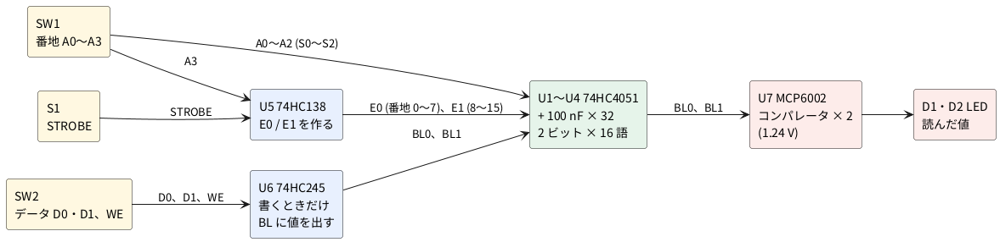
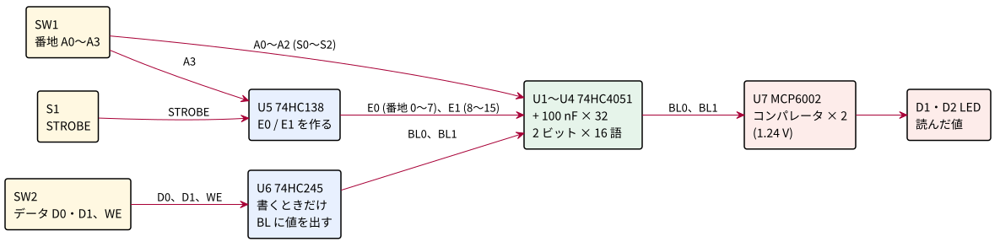
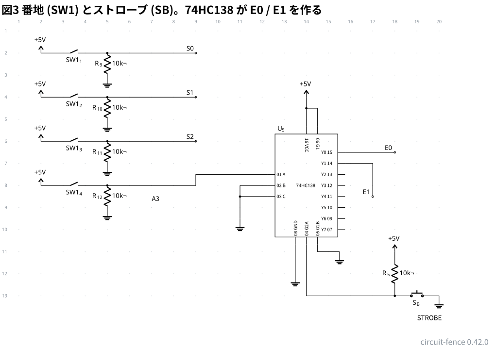
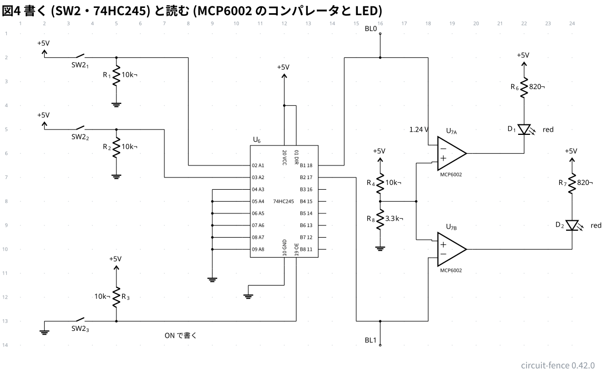
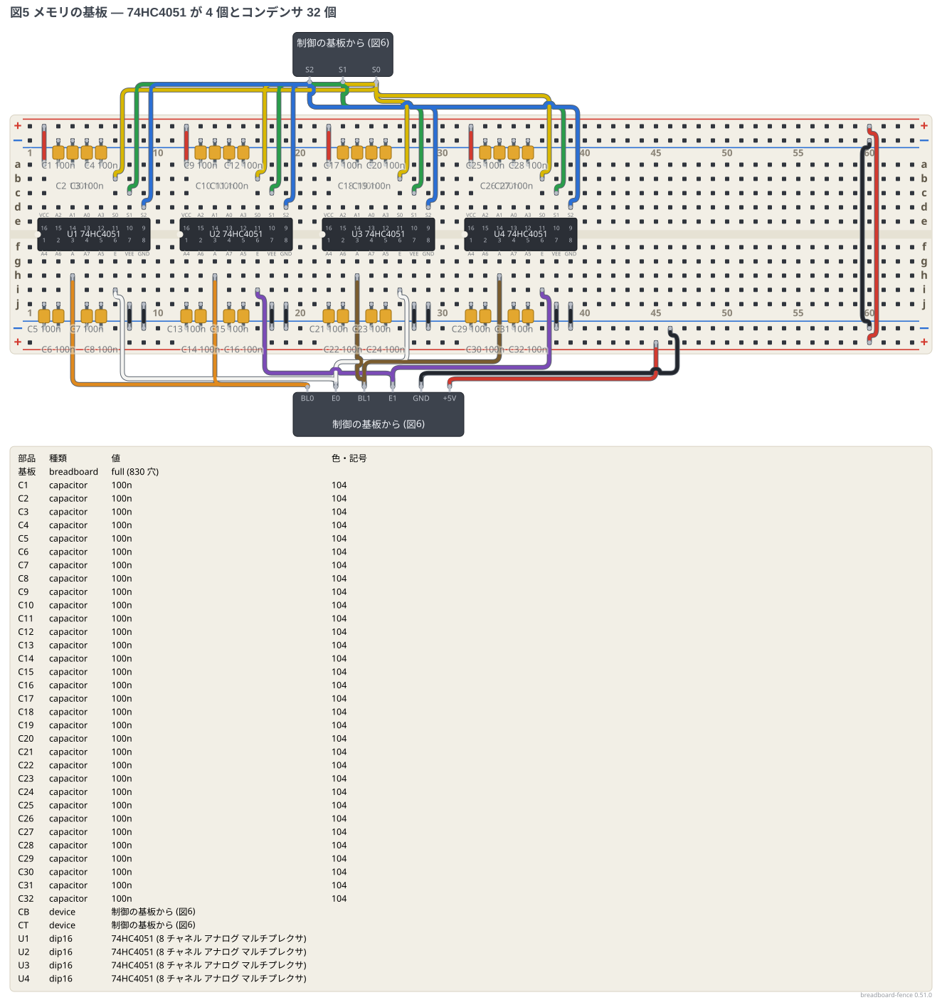
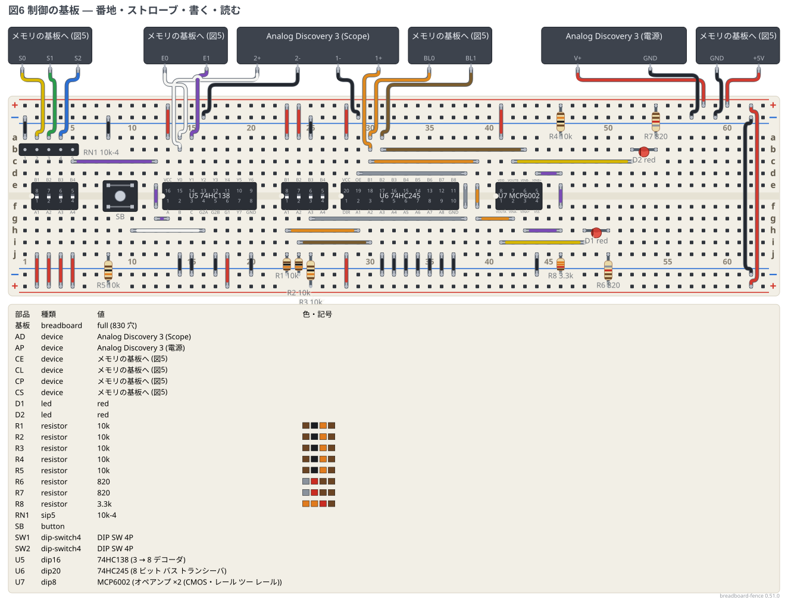
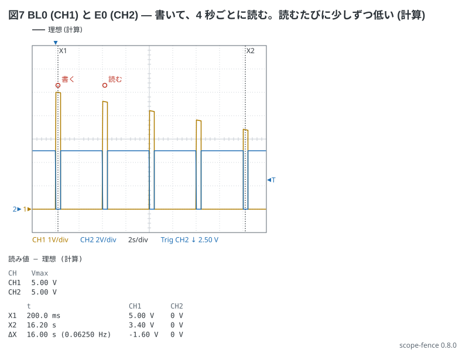

# 1-6 DRAM の配列 — 74HC4051 で 2 ビット × 16 語を組み、書いて読んで消えるまでを見る

[1-5](../../05-etc/01-cpu/05-dram-cell.md) のセル (スイッチ 1 個とコンデンサ 1 個) を 32 個並べて、**2 ビット × 16 語のメモリ**にする。
セルを 32 個も 2N7000 で組むと半田付けもジャンパも多すぎるので、
**CMOS のスイッチが 8 個と、3 ビットの番地で 1 個を選ぶデコーダが 1 つの IC に入った 74HC4051** を使う。
74HC4051 の中身は、DRAM の 1 行 (ワード線のデコーダとパストランジスタ 8 個) そのものだ。
1 ビットぶん 16 語は 74HC4051 が 2 個 (番地 0〜7 と 8〜15) で、2 ビットなら 4 個。コンデンサは 32 個。

メモリの基板とは別に、番地とデータを入れて読む**制御の基板**を組む。制御は 3 つの IC でできている。

1. **74HC138** (3 → 8 デコーダ): ボタン (STROBE) を押している間だけ、番地の最上位 A3 で決まる側 (0〜7 か 8〜15) の 4051 を開く (E0 / E1)
2. **74HC245** (バスドライバ): WE (書く) のとき、スイッチの値をビット線 BL0・BL1 に出す。WE でないときは切り離し、ビット線は浮く
3. **MCP6002** (コンパレータ × 2): ビット線の電圧を 1.24 V と比べ、LED に 1 / 0 を出す

同じメモリの基板を 4 枚作ると 8 ビット × 16 語になり、[1-4](../../05-etc/01-cpu/04-cpu-mimic.md) の CPU もどきのダイオード ROM (8 ビット × 16 語) を
**書き換えられるメモリ**に置き換えられる。それは別の題で扱う。

## 全体の構成





| 動き | すること | 何が起きるか |
| --- | --- | --- |
| 書く | SW1 で番地、SW2 で D0・D1 を決め、WE を ON にして **S1 を押す** | 74HC245 が BL に値を出し、S1 を押している間だけ番地のセル (4051 の 1 チャネル) が BL につながって、コンデンサがその電圧になる |
| 読む | WE を OFF にして、番地を決め、**S1 を押す** | BL は浮いているので、セルのコンデンサの電圧が BL に出る。コンパレータが 1.24 V と比べて LED に出す |
| 消える | 何もしない | セルの電荷が 4051 のオフのスイッチの漏れで抜ける。十数秒〜数分で LED が点かなくなる (漏れの個体差で大きく変わる)。消える前に書き戻す回路は [1-7](07-dram-refresh.md) |

1-5 と違う所が 2 つある。**ワード線を押すボタンが STROBE 1 つで、どの行を開くかは番地で決まる** (デコーダの仕事)。
そして **4051 のスイッチは N と P の相補対**なので、1-5 の 2N7000 で起きた「5 V − V<sub>GS</sub> までしか上がらない」が無く、セルは 5 V まで書ける。
実物の DRAM は N 形だけで作ってワード線を昇圧する。4051 は P 形を足して逃げている、と読んでほしい。

## 回路図

回路図は 4 枚。図1 がビット 0 のメモリ、図2 がビット 1 のメモリ (図1 と同じ形)、図3 が番地とストローブ、図4 が書く側と読む側だ。
**同じ名前の端子 (S0〜S2・E0・E1・BL0・BL1) は、図をまたいで同じ線**になる。

```circuit
# 回路図 (tommie-fence の circuit フェンス)
title: 図1 ビット 0 のメモリ (74HC4051 が 2 個とコンデンサ 16 個)
parts:
  U1: ic 12,8 74HC4051
  C1: capacitor 2,12 2,13.5
  C2: capacitor 3,12 3,13.5
  C3: capacitor 4,12 4,13.5
  C4: capacitor 5,12 5,13.5
  C5: capacitor 6,12 6,13.5
  C6: capacitor 7,12 7,13.5
  C7: capacitor 8,12 8,13.5
  C8: capacitor 9,12 9,13.5
  G1: ground 10,13.5
  VCC: vcc 12,4.5 5V
  G2: ground 11,15
  BL0: port 22,1.5
  U2: ic 28,8 74HC4051
  C9: capacitor 18,12 18,13.5
  C10: capacitor 19,12 19,13.5
  C11: capacitor 20,12 20,13.5
  C12: capacitor 21,12 21,13.5
  C13: capacitor 22,12 22,13.5
  C14: capacitor 23,12 23,13.5
  C15: capacitor 24,12 24,13.5
  C16: capacitor 25,12 25,13.5
  G3: ground 26,13.5
  VCC: vcc 28,4.5 5V
  G4: ground 27,15
  E0: port 2,16.5
  E1: port 38,16.5
  S2: port 2,17.5
  S1: port 2,18.5
  S0: port 2,19.5
  S2: port 38,17.5
  S1: port 38,18.5
  S0: port 38,19.5
wires:
  - U1.A0 -| 2,12
  - U1.A1 -| 3,12
  - U1.A2 -| 4,12
  - U1.A3 -| 5,12
  - U1.A4 -| 6,12
  - U1.A5 -| 7,12
  - U1.A6 -| 8,12
  - U1.A7 -| 9,12
  - 2,13.5 -- 3,13.5
  - 3,13.5 -- 4,13.5
  - 4,13.5 -- 5,13.5
  - 5,13.5 -- 6,13.5
  - 6,13.5 -- 7,13.5
  - 7,13.5 -- 8,13.5
  - 8,13.5 -- 9,13.5
  - 9,13.5 -- 10,13.5
  - U1.VCC |- 12,4.5
  - U1.GND |- 11,14.5
  - 11,14.5 -- 11,15
  - U1.VEE |- 11.5,14.5
  - 11.5,14.5 -- 11,14.5
  - U1.A -| 16,8
  - 16,8 -- 16,2.5
  - 16,2.5 -- 22,2.5
  - 22,2.5 -- 32,2.5
  - 22,2.5 -- 22,1.5
  - 32,2.5 |- U2.A
  - U2.A0 -| 18,12
  - U2.A1 -| 19,12
  - U2.A2 -| 20,12
  - U2.A3 -| 21,12
  - U2.A4 -| 22,12
  - U2.A5 -| 23,12
  - U2.A6 -| 24,12
  - U2.A7 -| 25,12
  - 18,13.5 -- 19,13.5
  - 19,13.5 -- 20,13.5
  - 20,13.5 -- 21,13.5
  - 21,13.5 -- 22,13.5
  - 22,13.5 -- 23,13.5
  - 23,13.5 -- 24,13.5
  - 24,13.5 -- 25,13.5
  - 25,13.5 -- 26,13.5
  - U2.VCC |- 28,4.5
  - U2.GND |- 27,14.5
  - 27,14.5 -- 27,15
  - U2.VEE |- 27.5,14.5
  - 27.5,14.5 -- 27,14.5
  - U1.E |- 12,16.5
  - 12,16.5 -- 2,16.5
  - U2.E |- 28,16.5
  - 28,16.5 -- 38,16.5
  - U1.S2 |- 13.5,17.5
  - 13.5,17.5 -- 2,17.5
  - U1.S1 |- 13,18.5
  - 13,18.5 -- 2,18.5
  - U1.S0 |- 12.5,19.5
  - 12.5,19.5 -- 2,19.5
  - U2.S2 |- 29.5,17.5
  - 29.5,17.5 -- 38,17.5
  - U2.S1 |- 29,18.5
  - 29,18.5 -- 38,18.5
  - U2.S0 |- 28.5,19.5
  - 28.5,19.5 -- 38,19.5
notes:
  - text 5.5,15 small: "番地 0 から 7 のセル (C1 から C8、全部 100 nF)"
  - text 21.5,15 small: "番地 8 から 15 のセル (C9 から C16)"
style:
  grid: off
  pitch: 1.2
```


- **74HC4051 の中身**: S0〜S2 の 3 ビットで A0〜A7 のどれか 1 つを共通端子 A につなぐ。E が L の間だけつながり、H なら全部切れる。
  つまり **S0〜S2 がワード線のデコーダ、A0〜A7 が 8 本のワード線の先のスイッチ、A がビット線**だ
- **番地の下 3 ビット (A0〜A2) を S0〜S2 に、最上位 A3 で U1 (0〜7) か U2 (8〜15) かを E0 / E1 で選ぶ。** E0 と E1 は図3 の 74HC138 が作る
- **各チャネルに 100 nF を 1 個**。これが 1 ビットのセルで、U1 の C1〜C8 が番地 0〜7、U2 の C9〜C16 が番地 8〜15 のビット 0 だ
- 2 つの IC の A をつないだ線が**ビット線 BL0**。書くときは図4 の 74HC245 が 5 V か 0 V に押し、読むときは浮かせてセルの電圧を見る
- VEE は負の電源の端子で、0〜5 V の信号なら GND につなぐ

```circuit
# 回路図 (tommie-fence の circuit フェンス)
title: 図2 ビット 1 のメモリ (図1 と同じ形。U3・U4、C17 から C32、BL1)
parts:
  U3: ic 12,8 74HC4051
  C17: capacitor 2,12 2,13.5
  C18: capacitor 3,12 3,13.5
  C19: capacitor 4,12 4,13.5
  C20: capacitor 5,12 5,13.5
  C21: capacitor 6,12 6,13.5
  C22: capacitor 7,12 7,13.5
  C23: capacitor 8,12 8,13.5
  C24: capacitor 9,12 9,13.5
  G1: ground 10,13.5
  VCC: vcc 12,4.5 5V
  G2: ground 11,15
  BL1: port 22,1.5
  U4: ic 28,8 74HC4051
  C25: capacitor 18,12 18,13.5
  C26: capacitor 19,12 19,13.5
  C27: capacitor 20,12 20,13.5
  C28: capacitor 21,12 21,13.5
  C29: capacitor 22,12 22,13.5
  C30: capacitor 23,12 23,13.5
  C31: capacitor 24,12 24,13.5
  C32: capacitor 25,12 25,13.5
  G3: ground 26,13.5
  VCC: vcc 28,4.5 5V
  G4: ground 27,15
  E0: port 2,16.5
  E1: port 38,16.5
  S2: port 2,17.5
  S1: port 2,18.5
  S0: port 2,19.5
  S2: port 38,17.5
  S1: port 38,18.5
  S0: port 38,19.5
wires:
  - U3.A0 -| 2,12
  - U3.A1 -| 3,12
  - U3.A2 -| 4,12
  - U3.A3 -| 5,12
  - U3.A4 -| 6,12
  - U3.A5 -| 7,12
  - U3.A6 -| 8,12
  - U3.A7 -| 9,12
  - 2,13.5 -- 3,13.5
  - 3,13.5 -- 4,13.5
  - 4,13.5 -- 5,13.5
  - 5,13.5 -- 6,13.5
  - 6,13.5 -- 7,13.5
  - 7,13.5 -- 8,13.5
  - 8,13.5 -- 9,13.5
  - 9,13.5 -- 10,13.5
  - U3.VCC |- 12,4.5
  - U3.GND |- 11,14.5
  - 11,14.5 -- 11,15
  - U3.VEE |- 11.5,14.5
  - 11.5,14.5 -- 11,14.5
  - U3.A -| 16,8
  - 16,8 -- 16,2.5
  - 16,2.5 -- 22,2.5
  - 22,2.5 -- 32,2.5
  - 22,2.5 -- 22,1.5
  - 32,2.5 |- U4.A
  - U4.A0 -| 18,12
  - U4.A1 -| 19,12
  - U4.A2 -| 20,12
  - U4.A3 -| 21,12
  - U4.A4 -| 22,12
  - U4.A5 -| 23,12
  - U4.A6 -| 24,12
  - U4.A7 -| 25,12
  - 18,13.5 -- 19,13.5
  - 19,13.5 -- 20,13.5
  - 20,13.5 -- 21,13.5
  - 21,13.5 -- 22,13.5
  - 22,13.5 -- 23,13.5
  - 23,13.5 -- 24,13.5
  - 24,13.5 -- 25,13.5
  - 25,13.5 -- 26,13.5
  - U4.VCC |- 28,4.5
  - U4.GND |- 27,14.5
  - 27,14.5 -- 27,15
  - U4.VEE |- 27.5,14.5
  - 27.5,14.5 -- 27,14.5
  - U3.E |- 12,16.5
  - 12,16.5 -- 2,16.5
  - U4.E |- 28,16.5
  - 28,16.5 -- 38,16.5
  - U3.S2 |- 13.5,17.5
  - 13.5,17.5 -- 2,17.5
  - U3.S1 |- 13,18.5
  - 13,18.5 -- 2,18.5
  - U3.S0 |- 12.5,19.5
  - 12.5,19.5 -- 2,19.5
  - U4.S2 |- 29.5,17.5
  - 29.5,17.5 -- 38,17.5
  - U4.S1 |- 29,18.5
  - 29,18.5 -- 38,18.5
  - U4.S0 |- 28.5,19.5
  - 28.5,19.5 -- 38,19.5
notes:
  - text 5.5,15 small: "番地 0 から 7 のセル (C17 から C24、全部 100 nF)"
  - text 21.5,15 small: "番地 8 から 15 のセル (C25 から C32)"
style:
  grid: off
  pitch: 1.2
```


- ビット 1 は、ビット 0 と同じ回路の名前を変えただけだ。S0〜S2・E0・E1 はビット 0 と共通で、ビット線だけ BL1 になる。
  ビットを増やすときも同じで、**番地の線は共通、ビット線だけが増える**

```circuit
# 回路図 (tommie-fence の circuit フェンス)
title: 図3 番地 (SW1) とストローブ (SB)。74HC138 が E0 / E1 を作る
parts:
  VCC: vcc 2,2 5V
  SA0: switch 2,2 5,2 l=$\mathrm{SW1}_1$
  R9: resistor 5,2 5,3 10k
  G1: ground 5,3
  S0: port 9,2
  VCC: vcc 2,4 5V
  SA1: switch 2,4 5,4 l=$\mathrm{SW1}_2$
  R10: resistor 5,4 5,5 10k
  G2: ground 5,5
  S1: port 9,4
  VCC: vcc 2,6 5V
  SA2: switch 2,6 5,6 l=$\mathrm{SW1}_3$
  R11: resistor 5,6 5,7 10k
  G3: ground 5,7
  S2: port 9,6
  VCC: vcc 2,8 5V
  SA3: switch 2,8 5,8 l=$\mathrm{SW1}_4$
  R12: resistor 5,8 5,9 10k
  G4: ground 5,9
  U5: ic 14,8 74HC138
  VCC: vcc 14,4 5V
  G5: ground 11,9.5
  G6: ground 15.5,11
  G7: ground 13.5,12
  VCC: vcc 18,11 5V
  R5: resistor 18,11 18,13 10k
  SB: button 18,13 20,13
  G8: ground 20,13
  E0: port 18,6.5
  E1: port 17,8.5
wires:
  - 5,2 -- 9,2
  - 5,4 -- 9,4
  - 5,6 -- 9,6
  - 5,8 -- 9,8
  - 9,8 |- U5.A
  - U5.B -| 11,8
  - U5.C -| 11,8.5
  - 11,8 -- 11,9.5
  - U5.VCC |- 14,4.5
  - 14,4.5 -- 14,4
  - U5.G1 |- 14.5,4.5
  - 14.5,4.5 -- 14,4.5
  - U5.G2B |- 14.5,11
  - 14.5,11 -- 15.5,11
  - U5.GND |- 13.5,12
  - U5.G2A |- 14,13
  - 14,13 -- 18,13
  - U5.Y0 -| 18,6.5
  - U5.Y1 -| 17,8.5
notes:
  - text 19,14 small: "STROBE"
  - text 7,8.6 small: "A3"
style:
  grid: on
  pitch: 1.2
```



- SW1 の 1〜3 番 (A0〜A2) は、そのままメモリの S0〜S2 になる。ON で 1 (+5 V)、OFF で 0 (10 kΩ で GND へ)
- **4 番 (A3) は 74HC138 の A に入り、B・C は 0**。G2A (L で働く) にストローブのボタン SB をつないだ。
  押していない間は R5 で H なので、Y0〜Y7 は全部 H (4051 は全部切れている)。
  **押すと、A3 = 0 なら Y0 が L (E0)、A3 = 1 なら Y1 が L (E1)** になり、片方の 4051 だけが開く
- 74HC138 は 3 → 8 のデコーダなので、B・C に番地の A4・A5 をつなげば、メモリの基板を 8 枚 (128 語) まで同じ作りで増やせる

```circuit
# 回路図 (tommie-fence の circuit フェンス)
title: 図4 書く (SW2・74HC245) と読む (MCP6002 のコンパレータと LED)
parts:
  VCC: vcc 2,2 5V
  SD0: switch 2,2 5,2 l=$\mathrm{SW2}_1$
  R1: resistor 5,2 5,3.5 10k
  G1: ground 5,3.5
  VCC: vcc 2,5 5V
  SD1: switch 2,5 5,5 l=$\mathrm{SW2}_2$
  R2: resistor 5,5 5,6.5 10k
  G2: ground 5,6.5
  GW: ground 2,13
  SWE: switch 2,13 5,13 l=$\mathrm{SW2}_3$
  R3: resistor 5,13 5,11 10k
  VCC: vcc 5,11 5V
  U6: ic 12,8 74HC245
  VCC: vcc 12,3 5V
  G3: ground 9,10.8
  G4: ground 10.5,11.5
  BL0: port 16,1
  BL1: port 16,14
  U7A: opamp 19,6 +down MCP6002
  U7B: opamp 19,10 +up MCP6002
  VCC: vcc 16,6.5 5V
  R4: resistor 16,6.5 16,8 10k
  R8: resistor 16,8 16,9.5 3.3k
  G5: ground 16,9.5
  VCC: vcc 22,2.5 5V
  R6: resistor 22,2.5 22,4 820
  D1: led 22,4 22,6 red
  VCC: vcc 24,6.5 5V
  R7: resistor 24,6.5 24,8 820
  D2: led 24,8 24,10 red
wires:
  - 5,2 -- 8,2
  - 8,2 -- 8,6.5
  - 8,6.5 -| U6.A1
  - 5,5 -- 7,5
  - 7,5 -- 7,7
  - 7,7 -| U6.A2
  - U6.A3 -| 9,7.5
  - U6.A4 -| 9,8
  - U6.A5 -| 9,8.5
  - U6.A6 -| 9,9
  - U6.A7 -| 9,9.5
  - U6.A8 -| 9,10
  - 9,7.5 -- 9,10.8
  - 5,13 -- 12.5,13
  - 12.5,13 |- U6.OE
  - U6.VCC |- 12,4
  - 12,4 -- 12,3
  - U6.DIR |- 12.5,4
  - 12.5,4 -- 12,4
  - U6.GND |- 12,11.5
  - 12,11.5 -- 10.5,11.5
  - U6.B1 -| 14.5,6.5
  - 14.5,6.5 -- 14.5,2
  - 14.5,2 -- 16,2
  - 16,2 -- 18,2
  - 16,2 -- 16,1
  - 18,2 |- U7A.-
  - U6.B2 -| 15,7
  - 15,7 -- 15,13
  - 15,13 -- 16,13
  - 16,13 -- 18,13
  - 16,13 -- 16,14
  - 18,13 |- U7B.-
  - 16,8 -- 17.5,8
  - 17.5,6.4 -- 17.5,9.6
  - 17.5,6.4 -| U7A.+
  - 17.5,9.6 -| U7B.+
  - U7A.out -- 22,6
  - U7B.out -- 24,10
notes:
  - text 17.2,5 small: "1.24 V"
  - text 7,13.6 small: "ON で書く"
style:
  grid: on
  pitch: 1.2
```



- **書く側**: SW2 の 1・2 番が D0・D1 (ON で 1)。3 番が WE で、**ON にすると 74HC245 の OE が L** になり、A1・A2 の値が B1・B2 = BL0・BL1 に出る。
  OFF なら R3 で OE が H になり、B 側は切り離されてビット線が浮く。DIR は H (A → B) に固定。使わない A3〜A8 は GND につなぐ
- **読む側**: MCP6002 の 2 回路をコンパレータに使う。−IN がビット線、+IN が R4・R8 で作った 1.24 V。
  **ビット線が 1.24 V より高いと出力が 0 V になり、+5 V から R6 (820 Ω) を通して LED が点く (= 1)**。
  1-5 と LED の向きが逆なのは、2 つの入力をビット線の出入りと交差させずに引くためで、働きは同じだ
- 読むときにビット線に載る物は、74HC245 の切り離した出力 (漏れ 0.5 µA 以下)、MCP6002 の入力 (1 pA)、配線の容量 (数十 pF) だけ。
  セルの 100 nF より桁違いに小さいので、1-5 と同じく**読んでもセルの値は壊れない**
- 4 枚のメモリの基板で 8 ビットにするときは、74HC245 の A3〜A8・B3〜B8 とコンパレータを増やす。74HC245 は 8 ビットぶんあるので足りる

## 実体配線図

**ブレッドボードは full 2 枚。** 1 枚めがメモリ (図5)、2 枚めが制御 (図6) で、9 本の線 (S0〜S2・E0・E1・BL0・BL1・GND・+5 V) でつなぐ。
メモリの基板は、ブレッドボードの作りがそのままセルの配列になる。**4051 の各チャネルのピンの列から、電源のレールの − へコンデンサを 1 本挿すだけ**で、
32 個のセルに配線は要らない。

```breadboard
# ブレッドボードの実体配線図 (tommie-fence の breadboard フェンス)
title: 図5 メモリの基板 — 74HC4051 が 4 個とコンデンサ 32 個
board: full
parts:
  CT:
    type: device
    at: top
    label: 制御の基板から (図6)
    pins: [S2, S1, S0]
  CB:
    type: device
    at: bottom
    label: 制御の基板から (図6)
    pins: [BL0, E0, BL1, E1, GND, +5V]
  U1: dip16 @ e2 74HC4051
  C1: capacitor a3 -t3 100n
  C2: capacitor a4 -t4 100n
  C3: capacitor a5 -t5 100n
  C4: capacitor a6 -t6 100n
  C5: capacitor j2 -b2 100n
  C6: capacitor j3 -b3 100n
  C7: capacitor j5 -b5 100n
  C8: capacitor j6 -b6 100n
  U2: dip16 @ e12 74HC4051
  C9: capacitor a13 -t13 100n
  C10: capacitor a14 -t14 100n
  C11: capacitor a15 -t15 100n
  C12: capacitor a16 -t16 100n
  C13: capacitor j12 -b12 100n
  C14: capacitor j13 -b13 100n
  C15: capacitor j15 -b15 100n
  C16: capacitor j16 -b16 100n
  U3: dip16 @ e22 74HC4051
  C17: capacitor a23 -t23 100n
  C18: capacitor a24 -t24 100n
  C19: capacitor a25 -t25 100n
  C20: capacitor a26 -t26 100n
  C21: capacitor j22 -b22 100n
  C22: capacitor j23 -b23 100n
  C23: capacitor j25 -b25 100n
  C24: capacitor j26 -b26 100n
  U4: dip16 @ e32 74HC4051
  C25: capacitor a33 -t33 100n
  C26: capacitor a34 -t34 100n
  C27: capacitor a35 -t35 100n
  C28: capacitor a36 -t36 100n
  C29: capacitor j32 -b32 100n
  C30: capacitor j33 -b33 100n
  C31: capacitor j35 -b35 100n
  C32: capacitor j36 -b36 100n
wires:
  - CB.+5V -- +b45 red
  - CB.GND -- -b46 black
  - +t60 -- +b60 red
  - -t60 -- -b60 black
  - a2 -- +t2 red
  - j8 -- -b8 black
  - j9 -- -b9 black
  - a12 -- +t12 red
  - j18 -- -b18 black
  - j19 -- -b19 black
  - a22 -- +t22 red
  - j28 -- -b28 black
  - j29 -- -b29 black
  - a32 -- +t32 red
  - j38 -- -b38 black
  - j39 -- -b39 black
  - CT.S0 -- b7 yellow
  - CT.S0 -- b17 yellow
  - CT.S0 -- b27 yellow
  - CT.S0 -- b37 yellow
  - CT.S1 -- c8 green
  - CT.S1 -- c18 green
  - CT.S1 -- c28 green
  - CT.S1 -- c38 green
  - CT.S2 -- d9 blue
  - CT.S2 -- d19 blue
  - CT.S2 -- d29 blue
  - CT.S2 -- d39 blue
  - CB.E0 -- i7 white
  - CB.E0 -- i27 white
  - CB.E1 -- i17 purple
  - CB.E1 -- i37 purple
  - CB.BL0 -- h4 orange
  - CB.BL0 -- h14 orange
  - CB.BL1 -- h24 brown
  - CB.BL1 -- h34 brown
```



- **電源**: 制御の基板の +5 V (赤) を下の + レールの 45 列に、GND (黒) を下の − レールの 46 列に入れる。上と下のレールは右端 (60 列) でつなぐ。
  **赤は +5 V の線だけ、黒は GND の線だけ**に使った
- **74HC4051 の向き**: 4 個とも切り欠きが左。U1 が 2〜9 列、U2 が 12〜19 列、U3 が 22〜29 列、U4 が 32〜39 列。
  上の組 (a〜e 行) に VCC・A2・A1・A0・A3・S0・S1・S2 (16 番から 9 番)、下の組 (f〜j 行) に A4・A6・A・A7・A5・E・VEE・GND (1 番から 8 番) が来る
- **コンデンサ**: 各 IC のチャネルの列 (上の組は 2〜5 番めの列、下の組は 1・2・4・5 番めの列) から、そちら側の − レールへ 100 nF を立てる。1 個が 1 セルだ。
  U1 なら上が C1〜C4 (3〜6 列)、下が C5〜C8 (2・3・5・6 列)。32 個の向きは問わない (無極性)
- **VCC** (各 IC の 1 列め、上) を上の + レールへ、**VEE と GND** (7・8 列め、下) を下の − レールへ
- **番地の線**: S0 (黄) は 4 個の IC の 6 列め、S1 (緑) は 7 列め、S2 (青) は 8 列めで、制御の基板から 1 本ずつ (合計 12 本) 挿す。
  IC どうしを数珠つなぎにすると、同じ穴に 2 本挿すことになるので、制御の側から放射状に引いた
- **E0** (白) は U1 と U3 の E (6 列め、下)、**E1** (紫) は U2 と U4 の E。**BL0** (橙) は U1 と U2 の A (3 列め、下)、**BL1** (茶) は U3 と U4 の A

```breadboard
# ブレッドボードの実体配線図 (tommie-fence の breadboard フェンス)
title: 図6 制御の基板 — 番地・ストローブ・書く・読む
board: full
parts:
  AD:
    type: device
    at: top
    label: Analog Discovery 3 (Scope)
    pins: [2+, 2-, 1-, 1+]
  AP:
    type: device
    at: top
    label: Analog Discovery 3 (電源)
    pins: [V+, GND]
  CS:
    type: device
    at: top
    label: メモリの基板へ (図5)
    pins: [S0, S1, S2]
  CE:
    type: device
    at: top
    label: メモリの基板へ (図5)
    pins: [E0, E1]
  CL:
    type: device
    at: top
    label: メモリの基板へ (図5)
    pins: [BL0, BL1]
  CP:
    type: device
    at: top
    label: メモリの基板へ (図5)
    pins: [GND, +5V]
  RN1: sip5 @ b1 l=10k-4 cap=right
  SW1: dip-switch4 @ e2
  SB: button @ f8
  R5: resistor j8 +b8 10k
  U5: dip16 @ e13 74HC138
  SW2: dip-switch4 @ e23
  R1: resistor j23 -b23 10k
  R2: resistor j24 -b24 10k
  R3: resistor j25 +b25 10k
  U6: dip20 @ e28 74HC245
  U7: dip8 @ e41 MCP6002
  R4: resistor a46 +t46 10k
  R8: resistor j46 -b46 3.3k
  R6: resistor j50 +b50 820
  D1: led h50(A) h48(K) red
  R7: resistor a54 +t54 820
  D2: led b54(A) b52(K) red
wires:
  - AP.V+ -- +t58 red
  - AP.GND -- -t57 black
  - CP.+5V -- +t60 red
  - CP.GND -- -t59 black
  - +t62 -- +b62 red
  - -t62 -- -b62 black
  - a1 -- -t1 black
  - j2 -- +b2 red
  - j3 -- +b3 red
  - j4 -- +b4 red
  - j5 -- +b5 red
  - CS.S0 -- a2 yellow
  - CS.S1 -- a3 green
  - CS.S2 -- a4 blue
  - c5 -- c12 purple
  - e12 -- f12 purple
  - g12 -- g13 purple
  - a8 -- -t8 black
  - h10 -- h16 white
  - a13 -- +t13 red
  - j14 -- -b14 black
  - j15 -- -b15 black
  - j17 -- -b17 black
  - j18 -- +b18 red
  - j20 -- -b20 black
  - CE.E0 -- a14 white
  - CE.E1 -- a15 purple
  - AD.2+ -- b14 white
  - AD.2- -- -t16 black
  - a23 -- +t23 red
  - a24 -- +t24 red
  - a25 -- -t25 black
  - h23 -- h29 orange
  - i24 -- i30 brown
  - g25 -- g38 gray
  - e38 -- f38 gray
  - d29 -- d38 gray
  - a28 -- +t28 red
  - j28 -- +b28 red
  - j31 -- -b31 black
  - j32 -- -b32 black
  - j33 -- -b33 black
  - j34 -- -b34 black
  - j35 -- -b35 black
  - j36 -- -b36 black
  - j37 -- -b37 black
  - CL.BL0 -- a30 orange
  - CL.BL1 -- a31 brown
  - AD.1+ -- b30 orange
  - AD.1- -- -t29 black
  - c30 -- c39 orange
  - e39 -- f39 orange
  - g39 -- g42 orange
  - b31 -- b43 brown
  - a41 -- +t41 red
  - j44 -- -b44 black
  - e46 -- f46 purple
  - d44 -- d46 purple
  - h43 -- h46 purple
  - i41 -- i48 yellow
  - c42 -- c52 yellow
```



- **電源**: AD3 の V+ (5 V、赤) を上の + レールの 58 列に、GND (黒) を 57 列に入れる。メモリの基板への +5 V と GND は 59・60 列から出す。上と下のレールは右端 (62 列) でつなぐ
- **SW1 (番地、2〜5 列)**: 下の組を +5 V (赤 4 本)、上の組が A0〜A3。集合抵抗 RN1 (10 kΩ × 4、5 ピン) を b 行の 1〜5 列に置き、共通のピン (1 列、`a1`) を上の − レールへ落とす。
  A0〜A2 (`a2`〜`a4`) はそのままメモリの基板の S0〜S2 へ。A3 は `c5`〜`c12` の紫で 12 列に送り、溝をまたいで下の組に下ろし、`g12`〜`g13` で U5 の A (13 列の下) へ
- **SB (STROBE、8・10 列)**: 下の組がストローブの線で、R5 (10 kΩ) で下の + レールへ引く (押していないと H)。上の組は `a8` から上の − レールへ。押すと L になる。
  `h10`〜`h16` の白で U5 の G2A (16 列の下) へ
- **U5 (74HC138、13〜20 列)**: 切り欠きが左。下の組に A・B・C・G2A・G2B・G1・Y7・GND (1 番から 8 番)、上の組に VCC・Y0〜Y6 (16 番から 9 番)。
  B・C・G2B (14・15・17 列の下) を下の − レールへ、G1 (18 列の下) を下の + レールへ、GND (20 列の下) を − レールへ、VCC (13 列の上) を上の + レールへ。
  **Y0 (14 列の上) が E0、Y1 (15 列の上) が E1** で、メモリの基板へ。AD3 の 2+ は `b14` (E0) に挿す
- **SW2 (データと WE、23〜26 列)**: 1・2 番 (D0・D1) は上の組を +5 V (赤)、下の組が値で、R1・R2 (10 kΩ) で下の − レールへ落とす。
  **3 番 (WE) は逆向き**で、上の組を − レール (黒)、下の組が WE の線。R3 (10 kΩ) で下の + レールへ引いてあるので、OFF で H、ON で L になる。4 番は使わない
- **U6 (74HC245、28〜37 列)**: 切り欠きが左。下の組に DIR・A1〜A8・GND (1 番から 10 番)、上の組に VCC・OE・B1〜B8 (20 番から 11 番)。
  DIR (28 列の下) を下の + レールへ (A → B)、A3〜A8 と GND (31〜37 列の下) を下の − レールへ、VCC (28 列の上) を上の + レールへ。
  D0 は `h23`〜`h29` の橙で A1 (29 列の下)、D1 は `i24`〜`i30` の茶で A2 (30 列の下)。
  WE は `g25`〜`g38` の灰で 38 列へ送り、溝をまたいで上の組に上げ、`d38`〜`d29` で OE (29 列の上) へ。
  **B1 (30 列の上) が BL0、B2 (31 列の上) が BL1** で、メモリの基板へ (`a30` `a31`)。AD3 の 1+ は `b30` (BL0)
- **U7 (MCP6002、41〜44 列)**: VDD (41 列の上) を上の + レールへ、VSS (44 列の下) を下の − レールへ。
  BL0 は `c30`〜`c39` の橙で 39 列へ、溝をまたいで下の組に下ろし、`g39`〜`g42` で VINA− (42 列の下)。BL1 は `b31`〜`b43` の茶で VINB− (43 列の上)。
  1.24 V は R4 (10 kΩ、46 列から上の + レール) と R8 (3.3 kΩ、46 列から下の − レール) で作り、46 列の溝をまたいで上下の組を同じ線にして、
  `d44`〜`d46` で VINB+ (44 列の上)、`h43`〜`h46` で VINA+ (43 列の下) へ (紫)
- **LED**: VOUTA (41 列の下) から `i41`〜`i48` の黄で D1 のカソード (48 列)、D1 のアノード (50 列) から R6 (820 Ω) で下の + レールへ。
  VOUTB (42 列の上) から `c42`〜`c52` の黄で D2 のカソード (52 列)、D2 のアノード (54 列) から R7 で上の + レールへ。**出力が L のとき点く (= 1)**
- **線の色**: 黄 = S0 と LED、緑 = S1、青 = S2、紫 = A3 と E1 と 1.24 V、白 = STROBE と E0、橙 = D0 と BL0、茶 = D1 と BL1、灰 = WE、赤 = +5 V、黒 = GND

### 回路図との対応

| 線の名前 | 回路図 | ブレッドボード |
| --- | --- | --- |
| S0〜S2 | SW1₁〜SW1₃ → 4051 の S0〜S2 | 図6 の `a2` `a3` `a4` → 図5 の各 IC の 6〜8 列め (上) |
| A3 | SW1₄ → 74HC138 の A | `c5` → `c12`、`e12` → `f12`、`g12` → `g13` |
| STROBE | SB → 74HC138 の G2A | `h10` → `h16` |
| E0 / E1 | 74HC138 の Y0 / Y1 → 4051 の E | 図6 の `a14` / `a15` → 図5 の U1・U3 / U2・U4 の 6 列め (下) |
| D0 / D1 | SW2₁ / SW2₂ → 74HC245 の A1 / A2 | `h23` → `h29` / `i24` → `i30` |
| WE | SW2₃ → 74HC245 の OE | `g25` → `g38`、`e38` → `f38`、`d38` → `d29` |
| BL0 | 74HC245 の B1、4051 の A、U7A の −IN | 図6 の `a30` → 図5 の U1・U2 の 3 列め (下)。`c30` → `c39`、`e39` → `f39`、`g39` → `g42` |
| BL1 | 74HC245 の B2、4051 の A、U7B の −IN | 図6 の `a31` → 図5 の U3・U4 の 3 列め (下)。`b31` → `b43` |
| 1.24 V | R4・R8 → U7A・U7B の +IN | `e46` → `f46`、`d44` → `d46`、`h43` → `h46` |

`breadboard-fence check` のネットリストは、この表のとおりだった。ネットリストと回路図のネットリストを比べ、
4051・138・245 の働きを当てて、下の「見るべき値」の手順どおりに動くことを確かめた (実機では測っていない)。

### ブレッドボードの限度の確認

電圧は 5 V。電流は、LED 2 つの 7.3 mA、プルダウン・プルアップの 10 kΩ が最大 6 本で 3 mA、1.24 V の分圧の 0.4 mA、
IC の静止電流 (合計 2 mA 以下) で、**合計は最大でも約 13 mA**。
周波数は、人がボタンを押す速さだけで、ブレッドボードの 3 MHz の限度に十分収まる。
4051 のオン抵抗 (最大 180 Ω) と 100 nF の時定数は 18 µs なので、ストローブを 0.1 ms 以上押せばセルは書き終わる。人の押す時間 (0.1 秒以上) で十分だ。

## 計器の設定

**計器は Analog Discovery 3 (AD3) 1 台**で、電源 (Supplies) と観測 (Scope) を兼ねる。制御の基板に置く。

| 計器 | 設定 |
| --- | --- |
| Supplies | V+ を 5 V にして Master Enable を入れる |
| Scope | CH1 = BL0 (ビット線 0)、CH2 = E0 (ストローブで開く線)。**Time 2 s/div**、Mode は Record (20 秒を記録)。CH1 1 V/div、CH2 2 V/div。Trigger は **CH2 の立ち下がり 2.5 V**、位置を左寄り (−4 div) にする。WaveForms の項目の名前は確認していない |
| 接続 | AD3 の GND を上の − レールへ。1− と 2− も − レールへ |

手順 (図7 のとおりに動かすとき。番地は 5、D0 = 1):

| 時刻 | すること | 見えるもの |
| --- | --- | --- |
| 準備 | SW1 を 0101 (番地 5)、SW2 の 1 番 ON (D0 = 1)、2 番 OFF (D1 = 0)、3 番 ON (WE) | CH1 (BL0) が 5 V (74HC245 が押している) |
| 0 s | **SB を 0.5 秒押す** (書く) | CH2 が 0 V に落ちる間に、番地 5 のセル (C6) が 5 V になる |
| 0.5 s | SW2 の 3 番を OFF (WE を切る) | CH1 がどこにもつながらず、0 V 近くに落ちる (浮いた線を AD3 の 1 MΩ が引く) |
| 4 s、8 s、12 s、16 s | **SB を 0.5 秒押す** (読む) | 押している間だけ CH1 がセルの電圧になり、LED (D1) が点く。押すたびに少しずつ低くなる |
| そのあと | 何度か読み続ける | CH1 が 1.24 V を切ると、LED が点かなくなる (値が消えた)。WE を ON にして SB を押せば書き直せる |

## 計器の画面

図7 は、上の手順で見えるはずの画面だ (漏れを 10 nA (0.1 V/s) と置いた計算で、実測ではない)。
読むたびに BL0 がセルの電圧に上がり、離すと浮いて 0 V 付近に戻る。カーソルは **X1 = 0.2 s** (書いている間) と **X2 = 16.2 s** (4 回めに読んでいる間) に置いた (時刻はトリガ = E0 が最初に落ちた所から数える)。

```scope
# オシロスコープの画面 (tommie-fence の scope フェンス)
title: 図7 BL0 (CH1) と E0 (CH2) — 書いて、4 秒ごとに読む。読むたびに少しずつ低い (計算)
time: 2s/div
trigger: ch2 falling 2.5V at -4div
ch1: {wave: "= step(t + 0.25s) * min(5V, 5V - 0.1V * t / 1s) * step(cos(6.2832 * t / 4s) - 0.95)", range: 1V/div, position: -3div}
ch2: {wave: = 5V - 5V * step(cos(6.2832 * t / 4s) - 0.95), range: 2V/div, position: -3div}
cursors: [0.2s, 16.2s]
measure: [vmax]
notes:
  - text 0.2s 5.3V: 書く
  - text 4.2s 5.3V: 読む
```



## 見るべき値 (目安)

| 項目 | 値 | 根拠 |
| --- | --- | --- |
| 書いた直後のセルの電圧 | **5 V** (1-5 の 3.5 V と違う) | 4051 は相補対のスイッチで、しきい値の落ちが無い |
| 書き終わるまでの時間 | 5τ ≒ 90 µs | オン抵抗 180 Ω (最大、25 °C) × 100 nF = 18 µs |
| 漏れによる下がり方 | **0.1 V/s** (10 nA の見積り)。最悪 1 V/s (100 nA) | 4051 のオフのスイッチの漏れは最大 ±100 nA (25 °C)。代表値は桁違いに小さいはずで、実測で確かめる |
| 読める時間 (1 と判定できる時間) | 10 nA なら約 38 秒、100 nA なら約 4 秒 | 5 V から 1.24 V まで |
| 読んだときのセルの電圧の減り | 1.5 mV | 配線の容量 30 pF と 100 nF の電荷の分配 |
| コンパレータのしきい値 | 1.24 V | 5 V × 3.3 ÷ (10 + 3.3) |
| LED の電流 | 3.7 mA | (5 − 1.9 − 0.1) ÷ 820。順方向電圧 1.9 V、出力の 0.1 V は仮定 |
| 図7 のカーソル | X1 (0.2 s) 5.00 V、X2 (16.2 s) 3.40 V | `scope-fence check` の読み値 |

- **漏れは IC ごと、チャネルごとに違う**。番地を変えて同じ実験をすると、消えるまでの時間が番地で違うのが見える。これが「DRAM のリフレッシュ周期は一番漏れるセルで決まる」の意味だ
- **温度**: 4051 を指で温めると速く消える。漏れは接合の逆方向電流で、10 °C で約 2 倍になる
- **浮いたビット線**: WE を切ると BL0 は 74HC245 からも切り離され、AD3 の 1 MΩ だけが残る。だから図7 では読んでいない間 0 V 近くに戻る。AD3 を外すと BL0 はどこにもつながらず、前の電圧が配線の容量に残るので、様子が違って見える
- **D1 = 0 のセル**は漏れても 0 のままで消えない。0 と 1 のどちらが消えるかは、セルのコンデンサのもう一方の端をどこにつなぐかで決まる (この題は GND)
- 別の番地に書いた値は、その番地を読むまで残っている。16 語ぶん書いて順に読むと、書いた順に消えていくのが見える

## 部品

電源は AD3 の V+ (5 V)。

| 記号 | 部品 | 値・型番 | 数 |
| --- | --- | --- | --- |
| U1〜U4 | 8 チャネル アナログマルチプレクサ (DIP-16) | 74HC4051 (CD74HC4051E など) | 4 |
| C1〜C32 | コンデンサ (フィルムかセラミック) | 100 nF (0.1 µF) | 32 |
| U5 | 3 → 8 デコーダ (DIP-16) | 74HC138 (SN74HC138N など) | 1 |
| U6 | 8 ビット バストランシーバ (DIP-20) | 74HC245 (SN74HC245N など) | 1 |
| U7 | レール to レール オペアンプ (DIP-8、2 回路) | MCP6002 | 1 |
| SW1、SW2 | 4 連 DIP スイッチ (DIP-8) | ピッチ 2.54 mm | 2 |
| SB | タクトスイッチ | 6 mm | 1 |
| RN1 | 集合抵抗 (SIL 5 ピン、共通付き) | 10 kΩ × 4 (図3 の R9〜R12 を兼ねる) | 1 |
| R1〜R3、R5 | 抵抗 (1/4 W) | 10 kΩ (R1・R2 = 図4 の R1・R2、R3 = 図4 の R3、R5 = 図3 の R5) | 4 |
| R4 | 抵抗 (1/4 W) | 10 kΩ (図4 の R4) | 1 |
| R8 | 抵抗 (1/4 W) | 3.3 kΩ | 1 |
| R6、R7 | 抵抗 (1/4 W) | 820 Ω | 2 |
| D1、D2 | LED 5 mm | 赤 | 2 |
| — | ブレッドボード | full 2 枚 | 2 |
| — | ジャンパ線 | 赤・黒・各色 (基板の間の 9 本は長めに) | 適宜 |

- 74HC4051 の代わりに 74HC4067 (16 チャネル、DIP-24) を使えば、1 ビット 16 語が IC 1 個で済む。ピンの並びが違うので、使うときはデータシートで引き直す
- 型番の入手性は確認していない

## LTspice での確かめ

4051・138・245 の論理は SPICE の対象外で、本文の動作表とデータシートの値による。`sim/06-dram-array.cir` で、オン抵抗 180 Ω を通して 100 nF を 5 V に書く .tran と、漏れ・しきい値・LED・電荷の分配の算術を .meas で確かめた。

| 項目 | 本文の数字 | LTspice | 判定 |
| --- | --- | --- | --- |
| 書き終わる (4.95 V に達する) まで | 約 90 µs | 83 µs (.tran。5τ の手前で 99 % に達する) | 合う |
| 時定数 180 Ω × 100 nF | 18 µs | 18 µs | 合う |
| 漏れの傾き (10 nA、100 nA) | 0.1 V/s、1 V/s | 0.1 V/s、1 V/s | 合う |
| 1 と読める時間 (10 nA、100 nA) | 約 38 秒、約 4 秒 | 37.6 s、3.76 s | 合う |
| しきい値 | 1.24 V | 1.241 V | 合う |
| LED の電流 | 3.7 mA | 3.66 mA | 合う |
| 読んだときのセルの減り (30 pF) | 1.5 mV | 1.5 mV | 合う |
| 全体の電流 | 約 13 mA | 12.7 mA | 合う |

## 出典

自作。DRAM の行のデコーダとパストランジスタの構成、リフレッシュ周期が一番漏れるセルで決まることは
[Dynamic Random Access Memory — Wikipedia](https://ja.wikipedia.org/wiki/Dynamic_Random_Access_Memory) による。
74HC4051 の働き (S0〜S2 で選ぶ、E が L で導通)・オン抵抗 (最大 180 Ω、4.5 V、25 °C)・オフの漏れ (最大 ±100 nA、25 °C) は
[TI の CD74HC4051 データシート (SCHS122O)](https://www.ti.com/lit/ds/symlink/cd74hc4051.pdf)、
74HC138 の真理値表 (G1 = H、G2A = G2B = L で A・B・C の番地の Y が L) は [TI の SN74HC138 データシート (SCLS107G)](https://www.ti.com/lit/ds/symlink/sn74hc138.pdf)、
74HC245 の働き (DIR = H で A → B、OE = L で出力) と切り離したときの漏れ (±0.5 µA、25 °C) は [TI の SN74HC245 データシート (SCLS131F)](https://www.ti.com/lit/ds/symlink/sn74hc245.pdf)、
MCP6002 の入力バイアス電流 (±1 pA 代表) は [Microchip の MCP6001/1R/1U/2/4 データシート (DS20001733L)](https://ww1.microchip.com/downloads/en/DeviceDoc/MCP6001-1R-1U-2-4-1-MHz-Low-Power-Op-Amp-DS20001733L.pdf) による。

- 漏れの電流 (10 nA) は見積りで、実測していない
- 74HC4067 は名前を挙げただけで、データシートを確かめていない
- 型番の入手性、WaveForms の Record の項目の名前は確認していない
