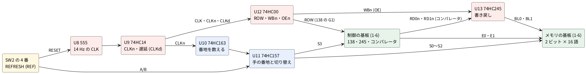
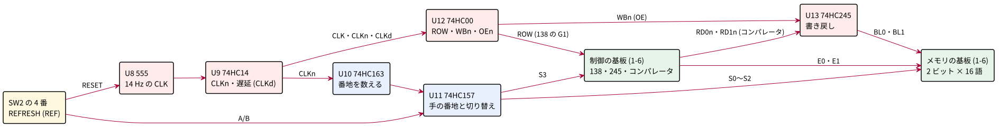
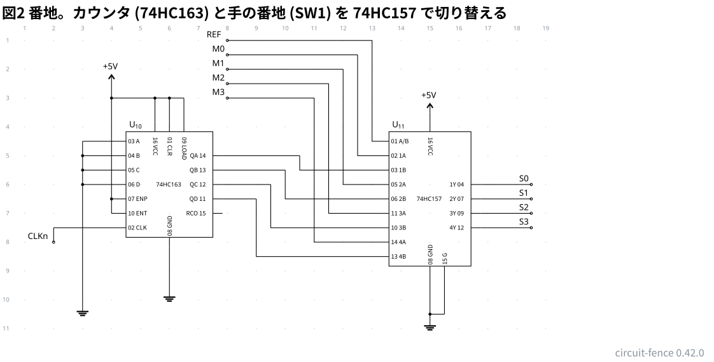
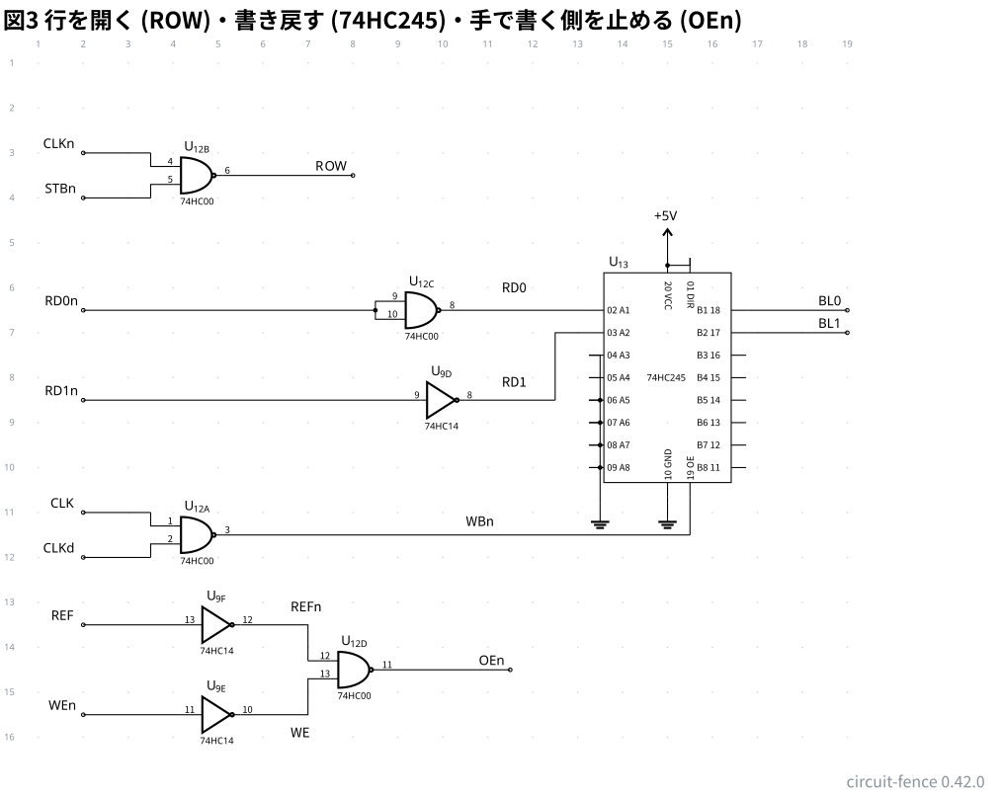
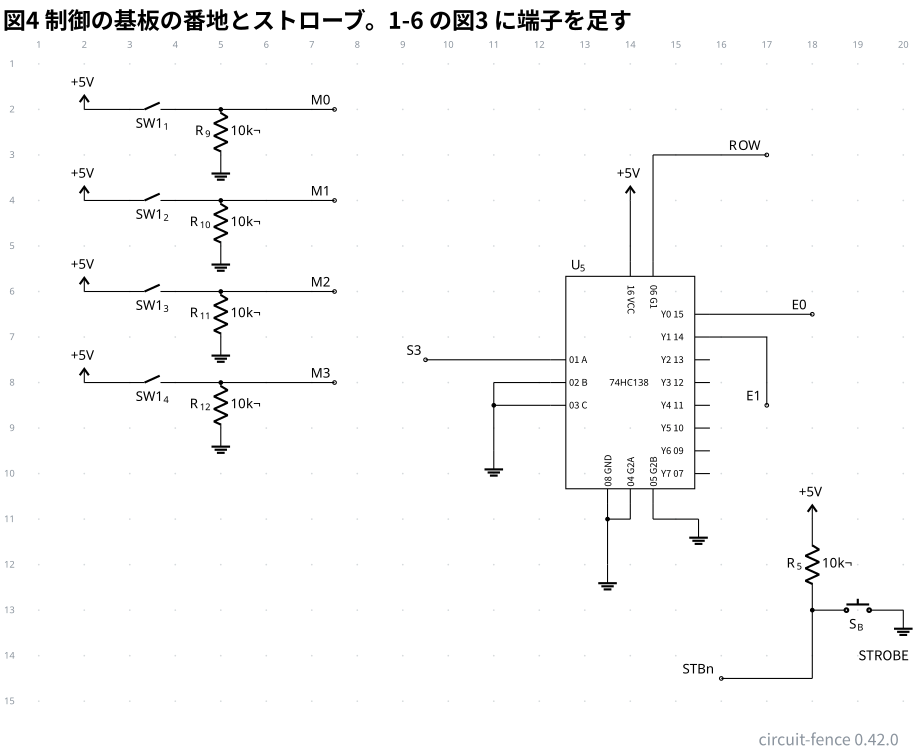
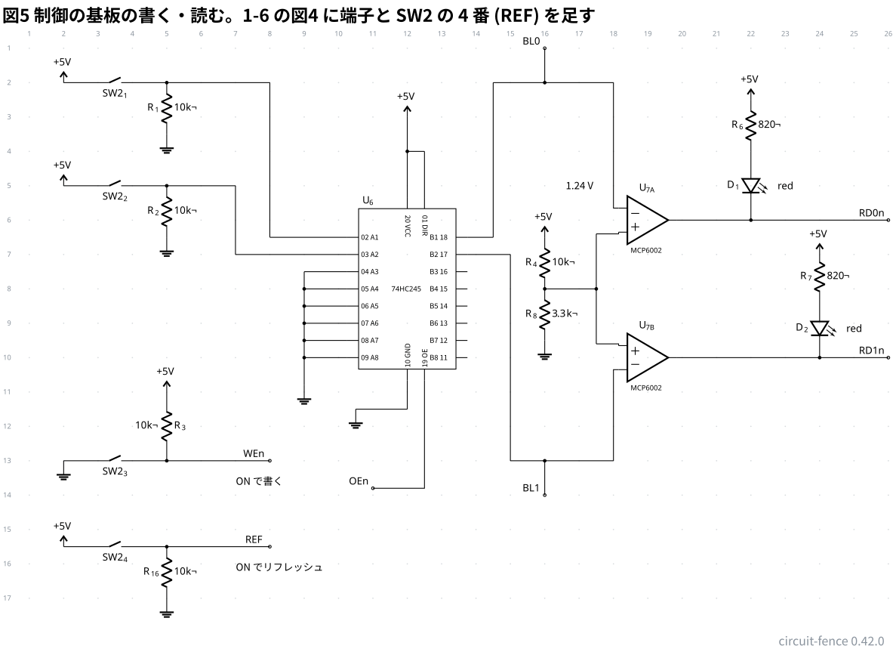
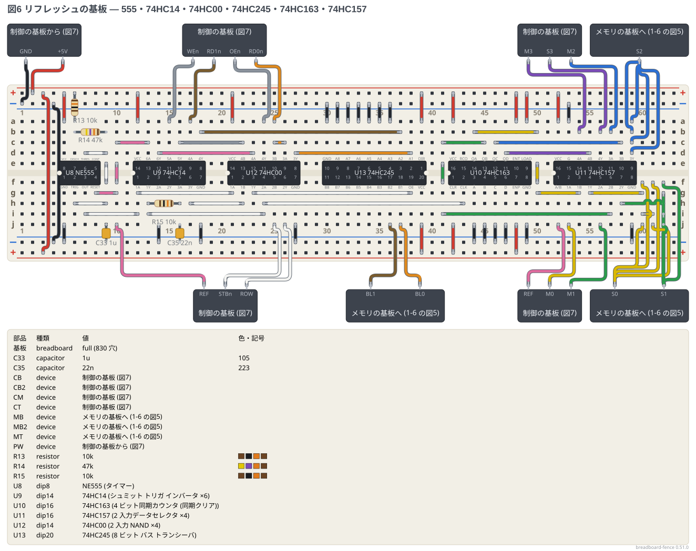
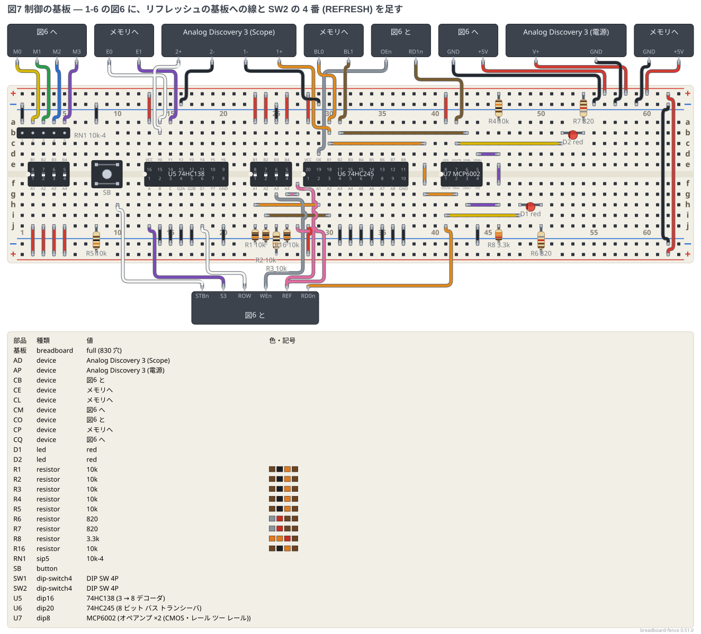
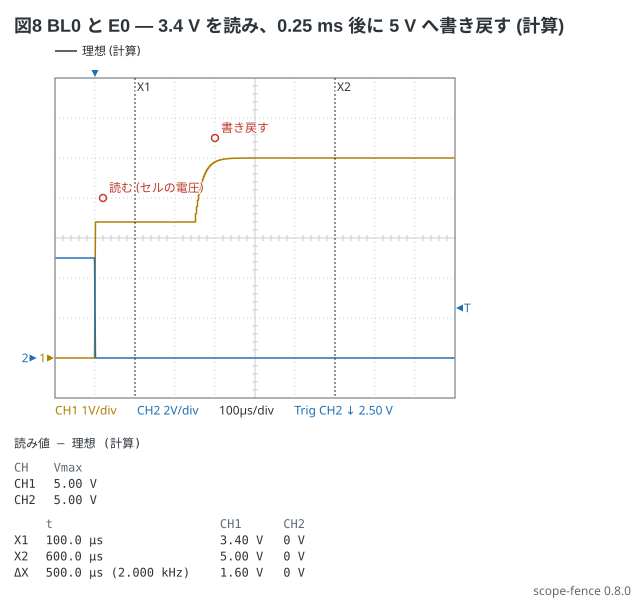

# 1-7 DRAM のリフレッシュ — 555 とカウンタで 16 行を回し、読んだ値を書き戻して消えなくする

[1-6](06-dram-array.md) の 2 ビット × 16 語のメモリは、何もしないと十数秒〜数分で値が消える。
この題では、**消える前に全部の行を順に読み、読んだ値を書き戻す回路 (リフレッシュ回路)** を足して、値を持ち続けさせる。
1-6 のメモリの基板と制御の基板はそのまま使い、**リフレッシュの基板**を 1 枚足して、制御の基板の線を数本つなぎ替える。

中身は [1-5](../../05-etc/01-cpu/05-dram-cell.md) の「読んで書き戻す」ボタン (S3) を、16 行ぶん自動で回すことだ。1 行ぶんの動きは次の 4 つ。

1. **行を開く**: 555 のクロック (CLK) が H になると、カウンタの番地の行の 4051 が開き、セルの電圧がビット線に出る
2. **読む**: 1-6 のコンパレータ (MCP6002) が、ビット線の電圧を 1.24 V と比べる
3. **書き戻す**: CLK を RC で約 0.25 ms 遅らせた CLKd が H になると、74HC245 (U13) がコンパレータの答え (1 なら 5 V、0 なら 0 V) をビット線に出し、セルを満たし直す
4. **閉じて次へ**: CLK が L になると行が閉じ、カウンタ (74HC163) が 1 つ進む

CLK は約 14 Hz (周期 72 ms) なので、16 行を**約 1.15 秒で一周**する。1-6 の見積りで一番速く消える場合 (漏れ 100 nA) でも、1 と読める時間は約 3.8 秒あるので、その 1/3 の間隔で書き戻すことになる。

| | この題 | 本物の DRAM |
| --- | --- | --- |
| 行を回す番地 | 74HC163 (4 ビット) | チップの中のリフレッシュカウンタ |
| 読む | コンパレータで 1.24 V と比べる | ビット線を V<sub>DD</sub>/2 に揃えてから、センスアンプで対のビット線と比べる |
| 書き戻す | 74HC245 がコンパレータの答えをビット線に出す | センスアンプがそのままビット線を電源の端まで振る |
| 一周の時間 | 約 1.15 秒 | 64 ms (多くの規格) |
| 手のアクセスとの調停 | REFRESH の間は手の番地と書き込みを切る | コントローラがリフレッシュの間にアクセスを待たせる |

## 全体の構成





| 時刻 (CLK の立ち上がりから) | 信号 | 何が起きるか |
| --- | --- | --- |
| 0 | CLK H、CLKn L → ROW H | 74HC138 が開き、番地の行の 4051 がセルをビット線につなぐ。コンパレータが読み始める |
| 約 0.25 ms | CLKd H → WBn L | 74HC245 (U13) がコンパレータの答えをビット線に出す。セルが 5 V か 0 V に戻る (整定は約 0.06 ms) |
| 39.5 ms | CLK L → ROW L、WBn H | 行が閉じ、U13 が切り離される。CLKn の立ち上がりでカウンタが 1 進む |
| 72 ms | CLK H | 次の行 |

## 回路図

回路図は 5 枚。図1〜3 がリフレッシュの基板、図4・5 が制御の基板 (1-6 の図3・図4 に端子を足した物)。
メモリの基板の回路図は 1-6 の図1・図2 のまま変えない。
**同じ名前の端子 (REF・CLK・CLKn・CLKd・S0〜S3・M0〜M3・ROW・STBn・WEn・OEn・RD0n・RD1n・BL0・BL1) は、図をまたいで同じ線**になる。
名前の末尾の n は「L で働く」(1-6 と同じ。WEn は L で書く、STBn は L でボタンが押されている)。

```circuit
# 回路図 (tommie-fence の circuit フェンス)
title: 図1 クロック (555) と遅延 (74HC14)。REF が H の間だけ 14 Hz で回る
parts:
  REF: port 2,2
  VCC: vcc 3,3 5V
  R13: resistor 3,3 3,5.5 10k
  R14: resistor 3,5.5 3,7 47k
  C33: capacitor 4,7 4,9 1u
  G1: ground 4,9
  U8: ic 6,6 NE555
  G2: ground 6,9
  U9A: not 11,6 74HC14
  CLK: port 14,4.8
  CLKn: port 17,4.8
  R15: resistor 13,6 13,8 10k
  C35: capacitor 13,8 13,9.5 22n
  G3: ground 13,9.5
  U9C: not 15.5,8 74HC14
  CLKd: port 18,8
wires:
  - U8.VCC |- 6,3
  - 3,3 -- 6,3
  - U8.RESET |- 6.5,2
  - 6.5,2 -- 2,2
  - U8.DISCH -| 3,5.5
  - U8.THRES -| 4,6
  - U8.TRIG -| 4,6.5
  - 4,6 -- 4,7
  - 3,7 -- 4,7
  - U8.GND |- 6,9
  - U8.OUT -| 9,6
  - 9,6 -- U9A.in
  - 9,6 -- 9,4.8
  - 9,4.8 -- 14,4.8
  - U9A.out -- 13,6
  - 13,6 -- 15,6
  - 15,6 -- 15,4.8
  - 15,4.8 -- 17,4.8
  - 13,8 -- U9C.in
  - U9C.out -- 18,8
notes:
  - text 4.6,10.4 small: "U8 の PIN 5 (CONT) は開放。U9B (PIN 3・4) は使わず、PIN 3 を GND へ"
style:
  grid: on
  pitch: 1.2
```


- **555 (U8) は 1-1 と同じ非安定の発振**。R13 = 10 kΩ、R14 = 47 kΩ、C33 = 1 µF で、
  H の時間は 0.693 × (10 k + 47 k) × 1 µ = 39.5 ms、L の時間は 0.693 × 47 k × 1 µ = 32.6 ms、周期 72.1 ms (13.9 Hz)
- **RESET (PIN 4) に REF をつなぐ**。REFRESH を切る (REF = L) と 555 は止まり、CLK は L のまま。だから REFRESH を切っている間は、行は手でしか開かない
- **U9A (PIN 1 → 2) が CLK を反転して CLKn を作る**。CLKn はカウンタのクロックと ROW に使う
- **遅延は CLKn に R15 (10 kΩ) と C35 (22 nF) を付けた RC**。CLK が上がると CLKn が下がり、C35 の電圧が 5 V からゆっくり下がる。
  シュミットトリガの U9C (PIN 5 → 6) は、入力が V<sub>T−</sub> (代表 1.6 V) を切った所で CLKd を H にする。
  遅れは 10 k × 22 n × ln(5 ÷ 1.6) = 0.25 ms (V<sub>T−</sub> の幅 0.9〜2.45 V で 0.16〜0.38 ms)。
  CLK が下がると CLKd も (C35 が充電されて V<sub>T+</sub> を越えた所で) 下がるが、そのときはもう CLK が L なので書き戻しは止まっている
- **0.25 ms 待つのは、コンパレータの答えが決まるのを待つため**。MCP6002 は帯域 1 MHz の OP アンプで、コンパレータとして使うと答えが出るまで数十 µs かかる (見積り)。待たずに書き戻すと、決まる前の答えを書いてしまう
- U9B (PIN 3・4) は使わない。CMOS の入力は浮かせないので PIN 3 を GND につなぐ

```circuit
# 回路図 (tommie-fence の circuit フェンス)
title: 図2 番地。カウンタ (74HC163) と手の番地 (SW1) を 74HC157 で切り替える
parts:
  CLKn: port 2,8
  U10: ic 6,6 74HC163
  VCC: vcc 4,2.5 5V
  G1: ground 3,10
  G2: ground 6,9.5
  U11: ic 15,6.5 74HC157
  VCC: vcc 15,3.5 5V
  G3: ground 15,10.5
  REF: port 8,1
  M0: port 8,1.5
  M1: port 8,2
  M2: port 8,2.5
  M3: port 8,3
  S0: port 18.5,6
  S1: port 18.5,6.5
  S2: port 18.5,7
  S3: port 18.5,7.5
wires:
  - U10.VCC |- 5.5,3
  - 4,3 -- 4,2.5
  - U10.CLR |- 6,3
  - U10.LOAD |- 6.5,3
  - 5.5,3 -- 6.5,3
  - U10.ENP -| 4,6.5
  - U10.ENT -| 4,7
  - 4,6.5 -- 4,3
  - 4,3 -- 5.5,3
  - 4,7 -- 4,6.5
  - U10.A -| 3,4.5
  - U10.B -| 3,5
  - U10.C -| 3,5.5
  - U10.D -| 3,6
  - 3,4.5 -- 3,10
  - U10.CLK -| 2,7.5
  - 2,7.5 -- 2,8
  - U10.GND |- 6,9.5
  - U10.QD -| 9,6.5
  - 9,6.5 |- U11.4B
  - U10.QC -| 9.5,6
  - 9.5,6 |- U11.3B
  - U10.QB -| 10,5.5
  - 10,5.5 |- U11.2B
  - U10.QA -| 10.5,5
  - 10.5,5 |- U11.1B
  - U11.A/B -| 13,1
  - 13,1 -- 8,1
  - U11.1A -| 12.5,1.5
  - 12.5,1.5 -- 8,1.5
  - U11.2A -| 12,2
  - 12,2 -- 8,2
  - U11.3A -| 11.5,2.5
  - 11.5,2.5 -- 8,2.5
  - U11.4A -| 11,3
  - 11,3 -- 8,3
  - U11.VCC |- 15,3.5
  - U11.GND |- 15,10.5
  - U11.G |- 15.5,10.5
  - 15.5,10.5 -- 15,10.5
  - U11.1Y -| 18.5,6
  - U11.2Y -| 18.5,6.5
  - U11.3Y -| 18.5,7
  - U11.4Y -| 18.5,7.5
style:
  grid: on
  pitch: 1.2
```



- **74HC163 (U10) は 4 ビットのカウンタ**。CLKn の立ち上がり (= CLK の立ち下がり = 行を閉じた所) で 1 進む。
  CLR・LOAD・ENP・ENT は +5 V (数えるだけ)、使わない A〜D は GND
- **74HC157 (U11) は 2 入力のセレクタ × 4**。A/B が L なら A 側 (手の番地 M0〜M3、SW1)、H なら B 側 (カウンタの QA〜QD) を Y に出す。
  **A/B に REF をつなぐ**ので、REFRESH を入れるとメモリの番地はカウンタの番地になる
- Y の 1Y〜3Y が S0〜S2 (メモリの基板の 4051 へ)、4Y が S3 (制御の基板の 74HC138 の A へ)。1-6 では SW1 が直接ここにつながっていた
- 1-6 の制御の基板で SW1 からメモリの基板へ行っていた線 (S0〜S2) と 74HC138 の A へ行っていた線 (A3) を、M0〜M3 としてこの基板へ持ってくる

```circuit
# 回路図 (tommie-fence の circuit フェンス)
title: 図3 行を開く (ROW)・書き戻す (74HC245)・手で書く側を止める (OEn)
parts:
  CLKn: port 2,3
  STBn: port 2,4
  U12B: nand 5,3.5 74HC00
  ROW: port 8,3.5
  RD0n: port 2,6.5
  U12C: nand 10,6.5 74HC00
  RD1n: port 2,8.5
  U9D: not 10,8.5 74HC14
  U13: ic 15,8 74HC245
  VCC: vcc 15,5 5V
  G1: ground 13.5,10.8
  G2: ground 15,10.8
  BL0: port 19,6.5
  BL1: port 19,7
  CLK: port 2,11
  CLKd: port 2,12
  U12A: nand 5,11.5 74HC00
  REF: port 2,13.5
  U9F: not 5,13.5 74HC14
  WEn: port 2,15.5
  U9E: not 5,15.5 74HC14
  U12D: nand 8.5,14.5 74HC00
  OEn: port 11.5,14.5
wires:
  - 2,3 -- 3.5,3
  - 3.5,3 |- U12B.a
  - 2,4 -- 3.5,4
  - 3.5,4 |- U12B.b
  - U12B.out -- 8,3.5
  - 2,6.5 -- 8.5,6.5
  - 8.5,6.5 |- U12C.a
  - 8.5,6.5 |- U12C.b
  - U12C.out -- U13.A1
  - 2,8.5 -- U9D.in
  - U9D.out -| 12.5,8.5
  - 12.5,8.5 |- U13.A2
  - U13.A3 -| 13.5,7.5
  - U13.A8 -| 13.5,10
  - 13.5,7.5 -- 13.5,10.8
  - U13.A4 -| 13.5,8.5
  - U13.A5 -| 13.5,9
  - U13.A6 -| 13.5,9.5
  - U13.A7 -| 13.5,10
  - U13.GND |- 15,10.8
  - U13.VCC |- 15,5.5
  - 15,5.5 -- 15,5
  - U13.DIR |- 15.5,5.5
  - 15.5,5.5 -- 15,5.5
  - U13.B1 -| 19,6.5
  - U13.B2 -| 19,7
  - 2,11 -- 3.5,11
  - 3.5,11 |- U12A.a
  - 2,12 -- 3.5,12
  - 3.5,12 |- U12A.b
  - U12A.out -| 15.5,11.5
  - 15.5,11.5 |- U13.OE
  - 2,13.5 -- U9F.in
  - 2,15.5 -- U9E.in
  - U9F.out -| 7,14.3
  - 7,14.3 |- U12D.a
  - U9E.out -| 7,15
  - 7,15 |- U12D.b
  - U12D.out -- 11.5,14.5
notes:
  - text 10.5,11.2 small: "WBn"
  - text 6.6,13.1 small: "REFn"
  - text 6.6,15.9 small: "WE"
  - text 11.3,6 small: "RD0"
  - text 11.3,8.1 small: "RD1"
style:
  grid: on
  pitch: 1.2
```



- **ROW = NAND(CLKn, STBn) = CLK または ボタン**。U12B (PIN 4・5 → 6)。ROW は制御の基板の 74HC138 の G1 に入る (1-6 では +5 V に固定していた)。
  74HC138 は G1 が H、G2A・G2B が L のときだけ開くので、**CLK が H の間か、STROBE を押している間**に行が開く
- **WBn = NAND(CLK, CLKd)**。U12A (PIN 1・2 → 3)。CLK と CLKd が両方 H、つまり行が開いてから 0.25 ms 後から行が閉じるまでの間だけ L になり、U13 の OE を開く
- **書き戻しの 74HC245 (U13)** は、DIR が H (A → B) で、A1・A2 にコンパレータの答え、B1・B2 がビット線 BL0・BL1。
  コンパレータの出力 RD0n・RD1n は 1-6 の LED を点けるため「1 で L」なので、反転して 1 を H にする。
  RD1n は U9D (PIN 9 → 8)、RD0n は U12C (PIN 9・10 → 8、NAND の 2 入力を束ねて反転に使う。74HC14 の 6 回路が埋まったため)
- **書き戻すとコンパレータとビット線が輪になる**。ビット線が 1.24 V より高ければ U13 がビット線を 5 V に押し、コンパレータは「高い」と言い続ける (低ければ 0 V で同じ)。
  この正帰還が DRAM のセンスアンプの「ラッチ」と同じ働きで、読んだ値をビット線の端 (0 V か 5 V) まで振り切る
- **OEn = NAND(REFn, WE)**。U12D (PIN 12・13 → 11)。REFn は U9F (PIN 13 → 12) で REF を反転、WE は U9E (PIN 11 → 10) で WEn を反転した物。
  OEn は制御の基板の 74HC245 (U6) の OE に入り、**REFRESH を切っていて、しかも WE が ON のときだけ** U6 がビット線を押す。
  リフレッシュ中に WE を入れたままでも、U6 と U13 がビット線を取り合わない
- 使わない A3〜A8 は GND。B3〜B8 は出力なので開放でよい

```circuit
# 回路図 (tommie-fence の circuit フェンス)
title: 図4 制御の基板の番地とストローブ。1-6 の図3 に端子を足す
parts:
  VCC: vcc 2,2 5V
  SA0: switch 2,2 5,2 l=$\mathrm{SW1}_1$
  R9: resistor 5,2 5,3 10k
  G1: ground 5,3
  M0: port 7.5,2
  VCC: vcc 2,4 5V
  SA1: switch 2,4 5,4 l=$\mathrm{SW1}_2$
  R10: resistor 5,4 5,5 10k
  G2: ground 5,5
  M1: port 7.5,4
  VCC: vcc 2,6 5V
  SA2: switch 2,6 5,6 l=$\mathrm{SW1}_3$
  R11: resistor 5,6 5,7 10k
  G3: ground 5,7
  M2: port 7.5,6
  VCC: vcc 2,8 5V
  SA3: switch 2,8 5,8 l=$\mathrm{SW1}_4$
  R12: resistor 5,8 5,9 10k
  G4: ground 5,9
  U5: ic 14,8 74HC138
  VCC: vcc 14,4 5V
  G5: ground 11,9.5
  G6: ground 15.5,11
  G7: ground 13.5,12
  VCC: vcc 18,11 5V
  R5: resistor 18,11 18,13 10k
  SB: button 18,13 20,13
  G8: ground 20,13
  E0: port 18,6.5
  M3: port 7.5,8
  S3: port 9.5,7.5
  ROW: port 17,3
  STBn: port 16,14.5
  E1: port 17,8.5
wires:
  - 5,2 -- 7.5,2
  - 5,4 -- 7.5,4
  - 5,6 -- 7.5,6
  - 5,8 -- 7.5,8
  - U5.A -| 9.5,7.5
  - U5.B -| 11,8
  - U5.C -| 11,8.5
  - 11,8 -- 11,9.5
  - U5.VCC |- 14,4
  - U5.G1 |- 14.5,3
  - 14.5,3 -- 17,3
  - U5.G2B |- 14.5,11
  - 14.5,11 -- 15.5,11
  - U5.GND |- 13.5,11
  - 13.5,11 -- 13.5,12
  - U5.G2A |- 14,11
  - 14,11 -- 13.5,11
  - 18,13 -- 18,14.5
  - 18,14.5 -- 16,14.5
  - U5.Y0 -| 18,6.5
  - U5.Y1 -| 17,8.5
notes:
  - text 19,14 small: "STROBE"
style:
  grid: on
  pitch: 1.2
```



- 1-6 の図3 から変えたのは 4 か所。**SW1 の 4 本 (M0〜M3) はリフレッシュの基板へ**行き、74HC138 の A には 157 の出力 **S3** が戻ってくる
- **G1 は ROW へ**、**G2A は GND へ** (1-6 では G1 が +5 V、G2A がボタン)。ボタンの線 **STBn** はリフレッシュの基板の U12B へ行く。
  ボタンを押したときに行が開くのは同じで、ROW (NAND) を通るぶん約 10 ns 遅れるだけだ
- 1-6 の図3 では、G1 の線が電源の線の途中に描かれていて、つながっていなかった (つながりの検査で浮いて見えた)。この図では端と端で結んだ

```circuit
# 回路図 (tommie-fence の circuit フェンス)
title: 図5 制御の基板の書く・読む。1-6 の図4 に端子と SW2 の 4 番 (REF) を足す
parts:
  VCC: vcc 2,2 5V
  SD0: switch 2,2 5,2 l=$\mathrm{SW2}_1$
  R1: resistor 5,2 5,3.5 10k
  G1: ground 5,3.5
  VCC: vcc 2,5 5V
  SD1: switch 2,5 5,5 l=$\mathrm{SW2}_2$
  R2: resistor 5,5 5,6.5 10k
  G2: ground 5,6.5
  GW: ground 2,13
  SWE: switch 2,13 5,13 l=$\mathrm{SW2}_3$
  R3: resistor 5,13 5,11 10k
  VCC: vcc 5,11 5V
  U6: ic 12,8 74HC245
  VCC: vcc 12,3 5V
  G3: ground 9,10.8
  G4: ground 10.5,11.5
  BL0: port 16,1
  BL1: port 16,14
  WEn: port 8,13
  VCC: vcc 2,15.5 5V
  SREF: switch 2,15.5 5,15.5 l=$\mathrm{SW2}_4$
  R16: resistor 5,15.5 5,17 10k
  G6: ground 5,17
  REF: port 8,15.5
  OEn: port 11,13.8
  RD0n: port 26,6
  RD1n: port 26,10
  U7A: opamp 19,6 +down MCP6002
  U7B: opamp 19,10 +up MCP6002
  VCC: vcc 16,6.5 5V
  R4: resistor 16,6.5 16,8 10k
  R8: resistor 16,8 16,9.5 3.3k
  G5: ground 16,9.5
  VCC: vcc 22,2.5 5V
  R6: resistor 22,2.5 22,4 820
  D1: led 22,4 22,6 red
  VCC: vcc 24,7 5V
  R7: resistor 24,7 24,8.3 820
  D2: led 24,8.3 24,10 red
wires:
  - 5,2 -- 8,2
  - 8,2 -- 8,6.5
  - 8,6.5 -| U6.A1
  - 5,5 -- 7,5
  - 7,5 -- 7,7
  - 7,7 -| U6.A2
  - U6.A3 -| 9,7.5
  - U6.A4 -| 9,8
  - U6.A5 -| 9,8.5
  - U6.A6 -| 9,9
  - U6.A7 -| 9,9.5
  - U6.A8 -| 9,10
  - 9,7.5 -- 9,10.8
  - 5,13 -- 8,13
  - 5,15.5 -- 8,15.5
  - U6.OE |- 11,13.8
  - U6.VCC |- 12,4
  - 12,4 -- 12,3
  - U6.DIR |- 12.5,4
  - 12.5,4 -- 12,4
  - U6.GND |- 12,11.5
  - 12,11.5 -- 10.5,11.5
  - U6.B1 -| 14.5,6.5
  - 14.5,6.5 -- 14.5,2
  - 14.5,2 -- 16,2
  - 16,2 -- 18,2
  - 16,2 -- 16,1
  - 18,2 |- U7A.-
  - U6.B2 -| 15,7
  - 15,7 -- 15,13
  - 15,13 -- 16,13
  - 16,13 -- 18,13
  - 16,13 -- 16,14
  - 18,13 |- U7B.-
  - 16,8 -- 17.5,8
  - 17.5,6.4 -- 17.5,9.6
  - 17.5,6.4 -| U7A.+
  - 17.5,9.6 -| U7B.+
  - U7A.out -- 22,6
  - 22,6 -- 26,6
  - U7B.out -- 24,10
  - 24,10 -- 26,10
notes:
  - text 16.6,5 small: "1.24 V"
  - text 7,13.6 small: "ON で書く"
  - text 7,16.1 small: "ON でリフレッシュ"
style:
  grid: on
  pitch: 1.2
```



- **SW2 の 4 番を REFRESH のスイッチにする**。1・2 番 (D0・D1) と同じ向きで、ON で REF が H (+5 V)、OFF で R16 (10 kΩ) が GND に引く
- **WE の線 (WEn) はリフレッシュの基板へ**行き、U6 の OE には戻ってきた **OEn** が入る。REFRESH を切っていれば、OEn は WEn と同じ (WE を入れると L)
- **コンパレータの出力 RD0n・RD1n を、LED の線から分けてリフレッシュの基板へ**送る。LED はそのまま点く。リフレッシュ中は行が変わるたびに LED が点いたり消えたりする (今開いている行の値を出すので)
- 1-6 の図4 では、U6 の DIR が電源の線の途中に描かれていて、つながっていなかった。この図では端と端で結んだ (1-6 の図も直した)

## 実体配線図

**ブレッドボードは full 3 枚。** 1-6 のメモリの基板 (1-6 の図5) と制御の基板 (図7) に、リフレッシュの基板 (図6) を足す。
メモリの基板はそのままで、挿す線の出所だけが変わる (下の表)。

```breadboard
# ブレッドボードの実体配線図 (tommie-fence の breadboard フェンス)
title: 図6 リフレッシュの基板 — 555・74HC14・74HC00・74HC245・74HC163・74HC157
board: full
parts:
  PW:
    type: device
    at: top
    label: 制御の基板から (図7)
    pins: [GND, +5V]
  CT:
    type: device
    at: top
    label: 制御の基板 (図7)
    pins: [WEn, RD1n, OEn, RD0n]
  CM:
    type: device
    at: top
    label: 制御の基板 (図7)
    pins: [M3, S3, M2]
  MT:
    type: device
    at: top
    label: メモリの基板へ (1-6 の図5)
    pins: [S2]
  CB:
    type: device
    at: bottom
    label: 制御の基板 (図7)
    pins: [REF, STBn, ROW]
  MB:
    type: device
    at: bottom
    label: メモリの基板へ (1-6 の図5)
    pins: [BL1, BL0]
  MB2:
    type: device
    at: bottom
    label: メモリの基板へ (1-6 の図5)
    pins: [S0, S1]
  CB2:
    type: device
    at: bottom
    label: 制御の基板 (図7)
    pins: [REF, M0, M1]
  U8: dip8 @ e5 NE555
  R13: resistor a6 +t6 10k cap=below:1,0
  R14: resistor b6 b9 47k
  C33: capacitor j9 -b9 1u
  U9: dip14 @ e12 74HC14
  R15: resistor h13 h16 10k cap=below:0,1
  C35: capacitor j16 -b16 22n
  U12: dip14 @ e21 74HC00
  U13: dip20 @ e30 r180 74HC245
  U10: dip16 @ e42 74HC163
  U11: dip16 @ e52 74HC157
wires:
  - PW.GND -- -t1 black
  - PW.+5V -- +t2 red
  - +t3 -- +b3 red
  - -t4 -- -b4 black
  - a5 -- +t5 red
  - j5 -- -b5 black
  - d7 -- d9 white
  - e9 -- f9 white
  - h6 -- h9 white
  - CB.REF -- j10 pink
  - g8 -- g10 pink
  - e10 -- f10 pink
  - c10 -- c13 pink
  - i7 -- i12 white
  - a12 -- +t12 red
  - j14 -- -b14 black
  - j18 -- -b18 black
  - d14 -- d23 pink
  - CT.WEn -- a15 gray
  - c16 -- c22 gray
  - CT.RD1n -- a17 brown
  - b18 -- b37 brown
  - g12 -- g21 white
  - h17 -- h22 white
  - i13 -- i24 white
  - a21 -- +t21 red
  - j27 -- -b27 black
  - CT.OEn -- a24 gray
  - CT.RD0n -- a25 orange
  - c25 -- c26 orange
  - d27 -- d38 orange
  - g23 -- g38 white
  - CB.STBn -- j25 white
  - CB.ROW -- j26 white
  - a30 -- -t30 black
  - a31 -- -t31 black
  - a32 -- -t32 black
  - a33 -- -t33 black
  - a34 -- -t34 black
  - a35 -- -t35 black
  - a36 -- -t36 black
  - a39 -- +t39 red
  - j39 -- +b39 red
  - MB.BL1 -- j36 brown
  - MB.BL0 -- j37 orange
  - h24 -- h43 white
  - a42 -- +t42 red
  - a48 -- +t48 red
  - a49 -- +t49 red
  - j42 -- +b42 red
  - j44 -- -b44 black
  - j45 -- -b45 black
  - j46 -- -b46 black
  - j47 -- -b47 black
  - j48 -- +b48 red
  - j49 -- -b49 black
  - b44 -- b50 yellow
  - e50 -- f50 yellow
  - g50 -- g54 yellow
  - c45 -- c41 green
  - e41 -- f41 green
  - i41 -- i57 green
  - c46 -- c58 blue
  - d47 -- d55 purple
  - a52 -- +t52 red
  - a53 -- -t53 black
  - j59 -- -b59 black
  - CB2.REF -- j52 pink
  - CB2.M0 -- j53 yellow
  - CB2.M1 -- j56 green
  - CM.M3 -- b54 purple
  - CM.S3 -- b56 purple
  - CM.M2 -- b57 blue
  - MT.S2 -- a59 blue
  - MT.S2 -- b59 blue
  - MT.S2 -- c59 blue
  - MT.S2 -- d59 blue
  - g55 -- g60 yellow
  - i60 -- i61 yellow
  - MB2.S0 -- f60 yellow
  - MB2.S0 -- j60 yellow
  - MB2.S0 -- f61 yellow
  - MB2.S0 -- j61 yellow
  - h58 -- h62 green
  - MB2.S1 -- f62 green
  - MB2.S1 -- g62 green
  - MB2.S1 -- i62 green
  - MB2.S1 -- j62 green
```



- **電源**: 制御の基板の +5 V と GND を、上のレールの左端 (2 列・1 列) に入れる。上と下のレールは左端 (3 列と 4 列) でつなぐ。
  **赤は +5 V の線だけ、黒は GND の線だけ**に使った
- **IC の向き**: 6 個とも切り欠きが左。ただし **U13 (74HC245) だけ 180° 回して**、A 側 (コンパレータの答えが入る) を上の組に、B 側と OE を下の組に置いた。
  上の組の線 (RD0・RD1) と下の組の線 (WBn) が溝をまたがずに済む。回したので切り欠きは右を向き、1 番ピン (DIR) は**右上 (39 列の上)** に来る
- **U8 (555、5〜8 列)**: R13 を 6 列 (DISCH) から上の + レールへ、R14 を `b6`〜`b9` (DISCH → 9 列)。
  9 列が THRES・TRIG・C33 の点で、THRES は `d7`〜`d9`、溝を `e9`〜`f9` でまたぎ、TRIG は `h6`〜`h9`、C33 (1 µF) を `j9` から下の − レールへ。CONT (8 列の上) は開放
- **REF (桃)**: 制御の基板から 2 本来る。1 本は `j10` に挿し、`g8`〜`g10` で 555 の RESET (8 列の下) へ、溝を `e10`〜`f10` でまたいで `c10`〜`c13` で U9 の 6A (13 列の上) へ。
  もう 1 本は `j52` で U11 の A/B へ
- **クロック (白)**: CLK は `i7`〜`i12` で U9 の 1A、`g12`〜`g21` で U12 の 1A。CLKn (U9 の 1Y、13 列の下) は R15 (`h13`〜`h16`) と、`i13`〜`i24` で U12 の 2A、
  `h24`〜`h43` で U10 の CLK へ。遅延の点は 16 列の下 (U9 の 3A) で、C35 (22 nF) を `j16` から − レールへ。CLKd (U9 の 3Y、17 列) は `h17`〜`h22` で U12 の 1B。
  WBn (U12 の 1Y、23 列) は `g23`〜`g38` で U13 の OE (38 列の下)
- **WE・OEn (灰)**: WEn は `a15` で U9 の 5A、WE (U9 の 5Y、16 列の上) は `c16`〜`c22` で U12 の 4B。REFn (U9 の 6Y、14 列の上) は `d14`〜`d23` で U12 の 4A (桃)。
  OEn は U12 の 4Y (`a24`) から制御の基板へ
- **書き戻し (橙・茶)**: RD0n は `a25` に挿し、`c25`〜`c26` で U12 の 3A・3B を束ね、RD0 (3Y、27 列) は `d27`〜`d38` で U13 の A1 (38 列の上)。
  RD1n は `a17` で U9 の 4A、RD1 (4Y、18 列) は `b18`〜`b37` で U13 の A2 (37 列の上)。U13 の B1・B2 (37・36 列の下) をメモリの基板の BL0・BL1 へ
- **番地 (1-6 と同じ色: 黄 = 0、緑 = 1、青 = 2、紫 = 3)**: カウンタの QA〜QD (44〜47 列の上) から 157 の B 側へ。
  QA は `b44`〜`b50`、溝を `e50`〜`f50`、`g50`〜`g54` で 1B。QB は `c45`〜`c41`、`e41`〜`f41`、`i41`〜`i57` で 2B。QC は `c46`〜`c58` で 3B、QD は `d47`〜`d55` で 4B
- **157 の出力**: S0 (1Y、55 列の下) は `g55`〜`g60`・`i60`〜`i61` で 60・61 列に広げ、メモリの基板へ 4 本。S1 (2Y、58 列) は `h58`〜`h62` で 62 列へ広げて 4 本。
  S2 (3Y、59 列の上) は 59 列から 4 本。1-6 と同じく、**4051 の 4 個へ 1 本ずつ放射状に**挿す (同じ穴に 2 本挿さないため)。S3 (4Y、56 列の上) は制御の基板へ 1 本
- U10 の CLR・ENP (下)・ENT・LOAD (上) を + レールへ、A〜D と GND を − レールへ。U11 の G を − レールへ。U9 の 2A (14 列の下) を − レールへ

```breadboard
# ブレッドボードの実体配線図 (tommie-fence の breadboard フェンス)
title: 図7 制御の基板 — 1-6 の図6 に、リフレッシュの基板への線と SW2 の 4 番 (REFRESH) を足す
board: full
parts:
  AD:
    type: device
    at: top
    label: Analog Discovery 3 (Scope)
    pins: [2+, 2-, 1-, 1+]
  AP:
    type: device
    at: top
    label: Analog Discovery 3 (電源)
    pins: [V+, GND]
  CM:
    type: device
    at: top
    label: 図6 へ
    pins: [M0, M1, M2, M3]
  CO:
    type: device
    at: top
    label: 図6 と
    pins: [OEn, RD1n]
  CQ:
    type: device
    at: top
    label: 図6 へ
    pins: [GND, +5V]
  CB:
    type: device
    at: bottom
    label: 図6 と
    pins: [STBn, S3, ROW, WEn, REF, RD0n]
  CE:
    type: device
    at: top
    label: メモリへ
    pins: [E0, E1]
  CL:
    type: device
    at: top
    label: メモリへ
    pins: [BL0, BL1]
  CP:
    type: device
    at: top
    label: メモリへ
    pins: [GND, +5V]
  RN1: sip5 @ b1 l=10k-4 cap=right
  SW1: dip-switch4 @ e2
  SB: button @ f8
  R5: resistor j8 +b8 10k
  U5: dip16 @ e13 74HC138
  SW2: dip-switch4 @ e23
  R1: resistor j23 -b23 10k
  R2: resistor j24 -b24 10k
  R3: resistor j25 +b25 10k
  R16: resistor j26 -b26 10k
  U6: dip20 @ e28 74HC245
  U7: dip8 @ e41 MCP6002
  R4: resistor a46 +t46 10k
  R8: resistor j46 -b46 3.3k
  R6: resistor j50 +b50 820
  D1: led h50(A) h48(K) red
  R7: resistor a54 +t54 820
  D2: led b54(A) b52(K) red
wires:
  - AP.V+ -- +t58 red
  - AP.GND -- -t57 black
  - CP.+5V -- +t60 red
  - CP.GND -- -t59 black
  - +t62 -- +b62 red
  - -t62 -- -b62 black
  - a1 -- -t1 black
  - j2 -- +b2 red
  - j3 -- +b3 red
  - j4 -- +b4 red
  - j5 -- +b5 red
  - CM.M0 -- a2 yellow
  - CM.M1 -- a3 green
  - CM.M2 -- a4 blue
  - CM.M3 -- a5 purple
  - CB.S3 -- j13 purple
  - a8 -- -t8 black
  - CB.STBn -- h10 white
  - j16 -- -b16 black
  - a13 -- +t13 red
  - j14 -- -b14 black
  - j15 -- -b15 black
  - j17 -- -b17 black
  - CB.ROW -- j18 white
  - j20 -- -b20 black
  - CE.E0 -- a14 white
  - CE.E1 -- a15 purple
  - AD.2+ -- b14 white
  - AD.2- -- -t16 black
  - a23 -- +t23 red
  - a24 -- +t24 red
  - a25 -- -t25 black
  - h23 -- h29 orange
  - i24 -- i30 brown
  - CB.WEn -- g25 gray
  - CO.OEn -- d29 gray
  - a26 -- +t26 red
  - g26 -- g27 pink
  - CB.REF -- f27 pink
  - CB.REF -- j27 pink
  - CB.RD0n -- j41 orange
  - CO.RD1n -- a42 brown
  - CQ.GND -- -t55 black
  - CQ.+5V -- +t56 red
  - a28 -- +t28 red
  - j28 -- +b28 red
  - j31 -- -b31 black
  - j32 -- -b32 black
  - j33 -- -b33 black
  - j34 -- -b34 black
  - j35 -- -b35 black
  - j36 -- -b36 black
  - j37 -- -b37 black
  - CL.BL0 -- a30 orange
  - CL.BL1 -- a31 brown
  - AD.1+ -- b30 orange
  - AD.1- -- -t29 black
  - c30 -- c39 orange
  - e39 -- f39 orange
  - g39 -- g42 orange
  - b31 -- b43 brown
  - a41 -- +t41 red
  - j44 -- -b44 black
  - e46 -- f46 purple
  - d44 -- d46 purple
  - h43 -- h46 purple
  - i41 -- i48 yellow
  - c42 -- c52 yellow
```



- 1-6 の図6 から外す線: SW1 から 74HC138 の A への紫 (`c5`〜`c12`・`e12`〜`f12`・`g12`〜`g13`)、STROBE の白 (`h10`〜`h16`)、G1 の赤 (`j18`)、WE の灰 (`g25`〜`g38`・`e38`〜`f38`・`d29`〜`d38`)。
  そして SW1 からメモリの基板へ行っていた S0〜S2 の 12 本
- 足す線: M0〜M3 (`a2`〜`a5`) をリフレッシュの基板へ、S3 を `j13` (U5 の A) へ、STBn を `h10` から、ROW を `j18` (U5 の G1) へ、G2A (`j16`) を − レールへ。
  WEn を `g25` から、OEn を `d29` (U6 の OE) へ。RD0n を `j41` (VOUTA) から、RD1n を `a42` (VOUTB) から
- **SW2 の 4 番 (26 列) が REFRESH**: 上の組を + レール (`a26`)、下の組を R16 (10 kΩ、`j26`) で − レールへ。26 列の下は `h26`・`i26` の上を D0・D1 の線が通るので、
  `g26`〜`g27` で 27 列へ渡し、`f27` と `j27` から REF を 2 本出す
- リフレッシュの基板への電源は、上のレールの 55・56 列から出す

**メモリの基板 (1-6 の図5) は部品も線も変えない。** 挿す線の出所だけが変わる。

| メモリの基板の穴 | 1-6 | この題 |
| --- | --- | --- |
| S0〜S2 (各 IC の 6〜8 列めの上、12 本) | 制御の基板の SW1 から | リフレッシュの基板の 157 の 1Y〜3Y から |
| BL0・BL1 (`h4` `h14` / `h24` `h34`) | 制御の基板の U6 の B1・B2 から | 同じ |
| 書き戻しの BL0・BL1 | — | リフレッシュの基板の U13 の B1・B2 から、空いている `g4` (U1 の A) と `g24` (U3 の A) へ足す |
| E0・E1・+5 V・GND | 制御の基板から | 同じ |

### 回路図との対応

| 線の名前 | 回路図 | ブレッドボード |
| --- | --- | --- |
| REF | SW2₄ → 555 の RESET、U9F、157 の A/B | 図7 の `f27` `j27` → 図6 の `j10` (→ `g8` RESET、`c13` 6A) と `j52` (A/B) |
| CLK | 555 の OUT → U9A、U12A | 図6 の `i7`〜`i12`、`g12`〜`g21` |
| CLKn | U9A → R15、U12B、163 の CLK | 図6 の `i13`〜`i24`、`h24`〜`h43` |
| CLKd | U9C → U12A | 図6 の `h17`〜`h22` |
| WBn | U12A → U13 の OE | 図6 の `g23`〜`g38` |
| ROW | U12B → 138 の G1 | 図6 の `j26` → 図7 の `j18` |
| STBn | SB → U12B | 図7 の `h10` → 図6 の `j25` |
| OEn | U12D → U6 の OE | 図6 の `a24` → 図7 の `d29` |
| WEn | SW2₃ → U9E | 図7 の `g25` → 図6 の `a15` |
| RD0n・RD1n | コンパレータ → U12C・U9D | 図7 の `j41`・`a42` → 図6 の `a25`・`a17` |
| M0〜M3 | SW1 → 157 の A 側 | 図7 の `a2`〜`a5` → 図6 の `j53` `j56` `b57` `b54` |
| S0〜S2 | 157 の 1Y〜3Y → 4051 の S0〜S2 | 図6 の 60〜62 列・59 列 → 1-6 の図5 の各 IC の 6〜8 列め (上) |
| S3 | 157 の 4Y → 138 の A | 図6 の `b56` → 図7 の `j13` |
| BL0・BL1 (書き戻し) | U13 の B1・B2 | 図6 の `j37`・`j36` → 1-6 の図5 の `g4`・`g24` |

`breadboard-fence check` のネットリストは、この表のとおりだった。回路図のネットリストと突き合わせ、
555・74HC14・74HC00 の働きを当てて、上の時刻の表どおりに動くことを確かめた (実機では測っていない)。

### ブレッドボードの限度の確認

電圧は 5 V。電流は、1-6 の約 13 mA に、NE555 の電源電流 (5 V で最大 6 mA)、555 の発振の抵抗 (0.1 mA)、R16 (0.5 mA)、
74HC の 4 個の静止電流 (合計 0.1 mA 以下) を足して、**最大でも約 20 mA**。
一番速い信号は 14 Hz の CLK と 0.25 ms の遅延で、ブレッドボードの 3 MHz の限度に十分収まる。

## 計器の設定

**計器は Analog Discovery 3 (AD3) 1 台**で、電源 (Supplies) と観測 (Scope) を兼ねる。1-6 と同じく制御の基板に置き、1-6 と同じ所を見る。

| 計器 | 設定 |
| --- | --- |
| Supplies | V+ を 5 V にして Master Enable を入れる |
| Scope | CH1 = BL0 (`b30`)、CH2 = E0 (`b14`)。**Time 100 µs/div**、位置を左寄り (−4 div)。CH1 1 V/div、CH2 2 V/div。Trigger は **CH2 の立ち下がり 2.5 V**、Mode は Single。WaveForms の項目の名前は確認していない |
| 接続 | AD3 の GND を上の − レールへ。1− と 2− も − レールへ |

手順 (図8 を見るとき):

| 時刻 | すること | 見えるもの |
| --- | --- | --- |
| 準備 | SW2 の 4 番 (REFRESH) を OFF。SW2 の 1 番 ON (D0 = 1)、3 番 ON (WE) | |
| 書く | SW1 で番地 0〜7 を順に選び、そのたびに SB を押す (8 語に 1 を書く) | |
| 待つ | SW2 の 3 番 (WE) を OFF にして **16 秒待つ** | セルが漏れて約 3.4 V に下がる (漏れ 10 nA の見積り) |
| 回す | Scope を Single で待たせてから、**SW2 の 4 番を ON** | 最初に開いた行 (0〜7 のどれか) で、CH1 が 3.4 V から 0.25 ms 後に 5 V へ上がる (図8) |
| 確かめる | そのまま 5 分おく。REFRESH を OFF にして、番地 0〜7 を SB で読む | LED (D1) が 8 語とも点く。**REFRESH を入れなかった場合**は 1-6 と同じく数十秒で消える |

- REFRESH を入れている間は、LED が行ごとに点滅する (今開いている行の値を出すため)。SB を押すと、その時のカウンタの行を読むだけで、値は変わらない
- REFRESH を入れている間に WE を入れても、U6 は OEn で止まっているので書けない (書くのは REFRESH を切ってから)

## 計器の画面

図8 は、上の手順の「回す」で見えるはずの画面だ (漏れを 10 nA と置いた計算で、実測ではない)。
カーソルは **X1 = 0.1 ms** (読んでいる間) と **X2 = 0.6 ms** (書き戻した後) に置いた (時刻はトリガ = E0 が落ちた所から数える)。

```scope
# オシロスコープの画面 (tommie-fence の scope フェンス)
title: 図8 BL0 と E0 — 3.4 V を読み、0.25 ms 後に 5 V へ書き戻す (計算)
time: 100us/div
trigger: ch2 falling 2.5V at -4div
ch1: {wave: "= step(t) * (3.4V + 1.6V * step(t - 0.25ms) * (1 - exp(-max(t - 0.25ms, 0s) / 18us)))", range: 1V/div, position: -3div}
ch2: {wave: = 5V - 5V * step(t), range: 2V/div, position: -3div}
cursors: [0.1ms, 0.6ms]
measure: [vmax]
notes:
  - text 0.02ms 4.0V: 読む (セルの電圧)
  - text 0.3ms 5.5V: 書き戻す
```



## 見るべき値 (目安)

| 項目 | 値 | 根拠 |
| --- | --- | --- |
| CLK の周期・周波数 | 72.1 ms・13.9 Hz | 0.693 × (10 k + 2 × 47 k) × 1 µ |
| CLK の H の時間 (行が開いている時間) | 39.5 ms | 0.693 × (10 k + 47 k) × 1 µ |
| 一周 (16 行) | **1.15 秒** | 16 × 72.1 ms |
| 1 と読める時間との比 | 3.3 倍 (漏れ 100 nA の最悪で) | 1-6 の 3.76 秒 ÷ 1.15 秒 |
| 書き戻しが始まるまで | **0.25 ms** (0.16〜0.38 ms) | 10 k × 22 n × ln(5 ÷ V<sub>T−</sub>)、V<sub>T−</sub> は 1.6 V (0.9〜2.45 V、4.5 V) |
| 書き戻しの整定 (3.4 V → 4.95 V) | 62 µs | オン抵抗 180 Ω × 100 nF × ln(1.6 ÷ 0.05) |
| 図8 のカーソル | X1 (0.1 ms) 3.40 V、X2 (0.6 ms) 5.00 V | `scope-fence check` の読み値 |
| 1 周のあいだの下がり (漏れ 10 nA) | 0.12 V | 0.1 V/s × 1.15 s。書き戻すたびに 5 V へ戻る |

- **書き戻しは「読んだ値」を書く**。1.24 V を切るまで放っておいたセルは 0 と読まれ、0 のまま書き戻される。リフレッシュは消えかけた値を救うのではなく、消える前に満たし直す仕組みだ
- **行を閉じる順番**: CLK が下がると、ROW が下がる (行を閉じる) のと、カウンタが進んで番地が変わるのが、どちらも数十 ns のうちに起きる。
  番地が先に変わっても、U13 はもう切れていて、浮いたビット線 (約 30 pF) が次のセル (100 nF) に一瞬つながるだけなので、セルの電圧は 0.1 % も動かない。
  本物の DRAM は、行を閉じてから番地を変える順を時刻で決めて守る
- 温度を上げると漏れが増えるが、一周 1.15 秒の間に下がるのは最悪でも約 1.2 V (100 nA)。1.24 V まではまだ余裕がある

## 部品

1-6 の部品はすべてそのまま使う。足す物:

| 記号 | 部品 | 値・型番 | 数 |
| --- | --- | --- | --- |
| U8 | タイマー (DIP-8) | NE555 | 1 |
| U9 | シュミットトリガ インバータ × 6 (DIP-14) | 74HC14 | 1 |
| U10 | 4 ビット同期カウンタ (DIP-16) | 74HC163 | 1 |
| U11 | 2 入力データセレクタ × 4 (DIP-16) | 74HC157 | 1 |
| U12 | 2 入力 NAND × 4 (DIP-14) | 74HC00 | 1 |
| U13 | 8 ビット バストランシーバ (DIP-20) | 74HC245 | 1 |
| R13、R15、R16 | 抵抗 (1/4 W) | 10 kΩ | 3 |
| R14 | 抵抗 (1/4 W) | 47 kΩ | 1 |
| C33 | コンデンサ (フィルムかセラミック) | 1 µF | 1 |
| C35 | コンデンサ (フィルムかセラミック) | 22 nF | 1 |
| — | ブレッドボード | full | 1 |
| — | ジャンパ線 | 各色 (基板の間の約 35 本は長めに) | 適宜 |

- NE555 の CONT (PIN 5) のバイパスのコンデンサは付けていない。付けるなら 10 nF を CONT と GND の間に
- 型番の入手性は確認していない

## LTspice での確かめ

74HC163・74HC157・74HC00 の論理は SPICE の対象外で、本文の時刻の表とデータシートの値による。
`sim/07-dram-refresh.cir` で、555 を「1/3・2/3 V<sub>CC</sub> で切り替わるスイッチ」で模した発振、CLKn の RC 遅延、書き戻しの整定を .tran で、残りを .meas の算術で確かめた。

| 項目 | 本文の数字 | LTspice | 判定 |
| --- | --- | --- | --- |
| CLK の周期 | 72.1 ms | 72.09 ms | 合う |
| CLK の周波数 | 13.9 Hz | 13.87 Hz | 合う |
| H の時間 | 39.5 ms | 39.51 ms | 合う |
| 一周 (16 行) | 1.15 秒 | 1.153 s | 合う |
| 書き戻しが始まるまで (V<sub>T−</sub> = 1.6 V) | 0.25 ms | 0.250 ms | 合う |
| 同 (V<sub>T−</sub> = 2.45 V・0.9 V) | 0.16〜0.38 ms | 0.157・0.377 ms | 合う |
| 書き戻しの整定 (3.4 V → 4.95 V) | 62 µs | 62.3 µs | 合う |
| 1 と読める時間との比 (100 nA) | 3.3 倍 | 3.26 | 合う |

## 出典

自作。DRAM のリフレッシュ (読んで書き戻す、リフレッシュカウンタ、センスアンプ、64 ms の周期) は
[Dynamic Random Access Memory — Wikipedia](https://ja.wikipedia.org/wiki/Dynamic_Random_Access_Memory) による。
NE555 の非安定の式と電源電流 (5 V で最大 6 mA) は [TI の NE555 データシート (SLFS022K)](https://www.ti.com/lit/ds/symlink/ne555.pdf)、
74HC14 のしきい値 (V<sub>T−</sub> 0.9〜2.45 V、代表 1.6 V、4.5 V) は [TI の SN74HC14 データシート (SCLS085L)](https://www.ti.com/lit/ds/symlink/sn74hc14.pdf)、
74HC163 の同期カウント (CLK の立ち上がりで進む) は [TI の SN74HC163 データシート (SCLS298D)](https://www.ti.com/lit/ds/symlink/sn74hc163.pdf)、
74HC157 の選択 (A/B が L で A 側) は [TI の SN74HC157 データシート (SCLS113F)](https://www.ti.com/lit/ds/symlink/sn74hc157.pdf)、
74HC00 は [TI の SN74HC00 データシート (SCLS181H)](https://www.ti.com/lit/ds/symlink/sn74hc00.pdf)、
74HC245 の働き (DIR = H で A → B、OE = L で出力) は [TI の SN74HC245 データシート (SCLS131F)](https://www.ti.com/lit/ds/symlink/sn74hc245.pdf) による。
4051・138・MCP6002 の値は 1-6 の出典のとおり。

- 漏れの電流 (10 nA) は 1-6 の見積りで、実測していない
- MCP6002 をコンパレータに使ったときの答えが出るまでの時間 (数十 µs) は見積りで、データシートの値ではない
- 型番の入手性、WaveForms の項目の名前は確認していない
